# multiplexd Internals

This document explains the reference implementation at the level where code is
too local and the specification is too normative: ownership, runtime topology,
cross-file control flow, and invariants.

The protocol contract, wire rules, and interoperability requirements belong in
[spec.md](spec.md). Enum inventories, field layouts, and single-function
mechanics belong in headers and nearby code comments. This file keeps only the
behavior that is hard to reconstruct from one file at a time.

## Contents

- [Contents](#contents)
- [1. Scope and Navigation](#1-scope-and-navigation)
  - [1.1 Component Overview](#11-component-overview)
  - [1.2 Control Ownership by Subsystem](#12-control-ownership-by-subsystem)
- [2. Ownership Model](#2-ownership-model)
- [3. Runtime State Carriers](#3-runtime-state-carriers)
- [4. State Transition Reference](#4-state-transition-reference)
  - [4.1 Session Progression](#41-session-progression)
  - [4.2 Stream Progression](#42-stream-progression)
- [5. libev Watcher Topology](#5-libev-watcher-topology)
  - [5.1 Watcher Coupling Flags](#51-watcher-coupling-flags)
- [6. Hello Handshake Processing](#6-hello-handshake-processing)
- [7. Inbound Data Path](#7-inbound-data-path)
- [8. Outbound Data Path](#8-outbound-data-path)
- [9. Scheduler and Control Batching Internals](#9-scheduler-and-control-batching-internals)
  - [9.1 Two-Phase Scheduling Model](#91-two-phase-scheduling-model)
  - [9.2 Ready Queue Fairness Model (DRR)](#92-ready-queue-fairness-model-drr)
  - [9.3 Control Packing and Tombstones](#93-control-packing-and-tombstones)
- [10. Flow-Control Bookkeeping and Backpressure](#10-flow-control-bookkeeping-and-backpressure)
  - [10.1 Counter Roles](#101-counter-roles)
  - [10.2 Critical Gating Rule](#102-critical-gating-rule)
  - [10.3 ACK Grant Triggering](#103-ack-grant-triggering)
  - [10.4 Receive-Buffer Pressure and Auto Window](#104-receive-buffer-pressure-and-auto-window)
- [11. Delayed ACK and Coalescing Timer Behavior](#11-delayed-ack-and-coalescing-timer-behavior)
- [12. BDP Estimator](#12-bdp-estimator)
  - [12.1 Core Equations](#121-core-equations)
  - [12.2 Probe Lifecycle](#122-probe-lifecycle)
  - [12.3 `effective_bdp` Update Rules](#123-effective_bdp-update-rules)
  - [12.4 Window Update and Lifecycle](#124-window-update-and-lifecycle)
- [13. Two Local I/O Modes](#13-two-local-io-modes)
- [14. Error Handling and Reset Semantics](#14-error-handling-and-reset-semantics)
  - [14.1 Session-Fatal Conditions](#141-session-fatal-conditions)
  - [14.2 Stream Abort Behavior](#142-stream-abort-behavior)
  - [14.3 RST Transmission and Unknown-Stream Handling](#143-rst-transmission-and-unknown-stream-handling)
  - [14.4 Session-Fatal Namespace Violations](#144-session-fatal-namespace-violations)
- [15. Teardown, Reconnect, and Idle Policies](#15-teardown-reconnect-and-idle-policies)
  - [15.1 Session Capacity and Inbound Startup Control](#151-session-capacity-and-inbound-startup-control)
- [16. Implementation Invariants for Maintainers](#16-implementation-invariants-for-maintainers)
- [17. Source Map (Implementation)](#17-source-map-implementation)
- [18. Counters Architecture](#18-counters-architecture)
- [19. Identity Extension](#19-identity-extension)
- [20. Tunnel Layer Threading Model](#20-tunnel-layer-threading-model)
  - [20.1 Ownership](#201-ownership)
  - [20.2 Cross-Loop Paths](#202-cross-loop-paths)
  - [20.3 Server-to-Tunnel Control Path](#203-server-to-tunnel-control-path)
  - [20.4 Synchronous Resume Lookup](#204-synchronous-resume-lookup)
  - [20.5 Close Event and Final Teardown](#205-close-event-and-final-teardown)
  - [20.6 Practical Invariants](#206-practical-invariants)
- [21. Configuration Reload](#21-configuration-reload)
  - [21.1 Synchronous Phase](#211-synchronous-phase)
  - [21.2 Drain Behavior](#212-drain-behavior)
  - [21.3 Asynchronous Reconnect](#213-asynchronous-reconnect)
- [22. Per-Tunnel Frame Allocation](#22-per-tunnel-frame-allocation)
- [23. lossymux Datagram Relay](#23-lossymux-datagram-relay)
  - [23.1 Wire-Side Datagram Path](#231-wire-side-datagram-path)
  - [23.2 UDP Side: Listeners and Flows](#232-udp-side-listeners-and-flows)
  - [23.3 Drop Points](#233-drop-points)
  - [23.4 Lifetimes and Reload](#234-lifetimes-and-reload)

## 1. Scope and Navigation

Use this file for:

- runtime topology across listener, tunnel, session, and stream;
- send and receive paths through queues, buffers, watchers, and timers;
- fairness, backpressure, delayed flush, and resume behavior;
- teardown and late-traffic handling that span multiple modules;
- maintainer-facing invariants that are easy to break during refactors.

Do not use this file for:

- normative protocol rules, frame semantics, or wire compatibility;
- exhaustive API or enum listings;
- field-by-field struct descriptions.

### 1.1 Component Overview

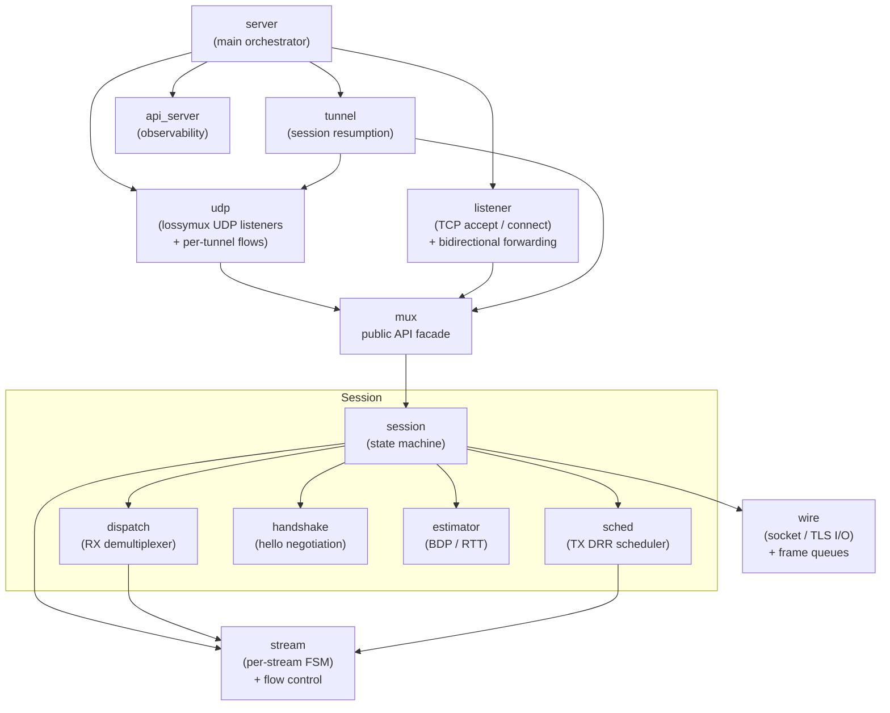

This graph is the ownership map for the rest of the document: listener and
tunnel connect the process to the mux core;
session is the coordination object; dispatch, sched, handshake, estimator, and wire each own one slice of
behavior but coordinate only through session and stream state.

### 1.2 Control Ownership by Subsystem

| Question                                                  | Owning code            |
| --------------------------------------------------------- | ---------------------- |
| Session construction, transport lifecycle, suspend/resume | `mux.c`, `session.c`   |
| Receive parse, stream lookup, namespace checks            | `recv.c`               |
| Outbound fairness, control batching, delayed flush        | `sched.c`              |
| Hello parsing, capability latching, resume handshake      | `handshake.c`          |
| Adaptive window growth                                    | `estimator.c`          |
| Reconnect policy, cross-thread relay, top-level ownership | `tunnel.c`, `server.c` |
| Configuration reload sequencing and live drain dispatch   | `server.c`             |
| lossymux UDP sockets, client routes, flow table           | `udp.c`                |

## 2. Ownership Model

The public mux API is intentionally thin. Most entry points schedule or forward
work into session and stream internals rather than owning policy themselves.

| Surface                            | Underlying Behavior                                                                                             |
| ---------------------------------- | --------------------------------------------------------------------------------------------------------------- |
| `mux_new` / `mux_close`            | Construct and finally release the session coordination object, including watchers, queues, and counters wiring. |
| `mux_start` / `mux_attach_fd`      | Choose between accepted-session handshake, outbound connect, or resume re-entry.                                |
| `mux_open_stream` / `mux_stream_*` | Mutate per-stream state, but always under session ownership on one libev loop thread.                           |
| `on_accept`                        | The only admission control point for passive-open streams.                                                      |
| `on_resume`                        | May replace a transient accepted session with a suspended session that steals the new transport.                |
| `MUX_EVENT_CLOSED`                 | Notification only; ownership is released later by `mux_close()`.                                                |

All mux and stream transitions remain single-threaded. The tunnel layer exists
to preserve that invariant when the process hosts multiple sessions; the
threading rules live in §20.

## 3. Runtime State Carriers

| Object  | Owns                                                                                                                                                                | Implicit Consequence                                                                                                                          |
| ------- | ------------------------------------------------------------------------------------------------------------------------------------------------------------------- | --------------------------------------------------------------------------------------------------------------------------------------------- |
| Session | transport fd/TLS state, session sendbuf and oobbuf, fixed receive ring, unacked list, retransmit cursor, stream table, ready queue, timers, optional stats pointers | It is the only place where dispatch, sched, handshake, estimator, and wire meet; none of those submodules owns transport state independently. |
| Stream  | send queue, receive ring sized by `recv_window`, flow-control counters, half-close/reset flags, local I/O mode, coalescing membership                               | A stream can be logically closed before it disappears from the table; tombstone retention keeps late traffic deterministic.                   |

State enums are defined in `session.h` and `stream.h`; the diagrams below retain
only the transitions whose runtime coupling is referenced elsewhere in this document.

## 4. State Transition Reference

### 4.1 Session Progression

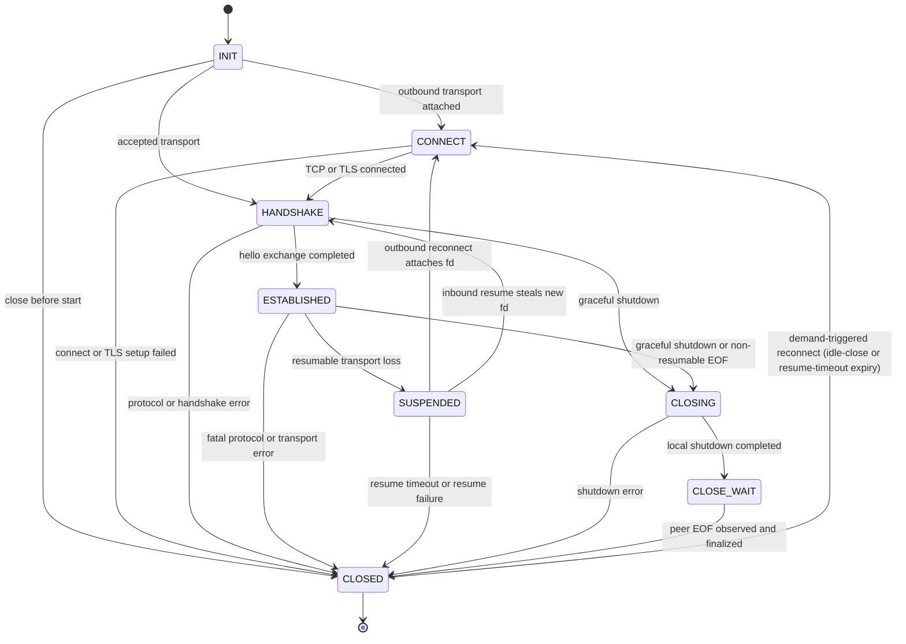

The enum names are less important than the control handoff: outbound reconnect
returns through CONNECT, inbound resume re-enters HANDSHAKE on a different
transport, and terminal `session_reset` skips the suspend path entirely.
The public API exposes a simplified `enum mux_state` with five externally
visible states (`ESTABLISHED`, `CONNECT`, `CLOSED`, `SUSPENDED`, `CLOSING`) via
`mux_state()`, which collapses the internal `SESSION_INIT`/`SESSION_HANDSHAKE` →
`CONNECT` and `SESSION_CLOSING`/`SESSION_CLOSE_WAIT` → `CLOSING`.
`CLOSING` is deliberately not folded into either neighbour: consumers treat
`CLOSED` as redialable (`mux_attach_fd()` accepts it) and `ESTABLISHED` as
usable, and a shutting-down session is neither. Folding it into `ESTABLISHED`
would let `server_on_resume_lookup` pick a closing tunnel as a resume target,
whose `session_resume_attach` then drops the handoff and discards the peer's
fresh transport; folding it into `CLOSED` would let `open_stream_task`'s
demand-reconnect call `mux_attach_fd()` on a closing session and trip its
`CHECKMSGF`.
Losing an established transport is observable on both roles: dialed and
accepted sessions both emit `MUX_EVENT_SUSPENDED`, while reconnect policy
remains a tunnel-layer decision.

One additional entry into `SESSION_SUSPENDED` is not shown in the diagram: a
client session (`!accepted`) that has already received a `session_id` from the
server returns from its resume attempt's `SESSION_CONNECT` or
`SESSION_HANDSHAKE` straight to `SESSION_SUSPENDED` when the attempt fails --
an asynchronous connect error, a transport error (a failed recv/send or a TLS
close_notify), or a connect timeout (`w_connect_timeout` expiring before the
attempt completes: a slow or blackholed attempt does not mean the server has
dropped the session). This preserves streams and the unacked list for replay
even if the session was never fully established. Such a return emits
`MUX_EVENT_CONNECT_FAILED` rather than `MUX_EVENT_SUSPENDED`, so the tunnel
paces the next attempt through its reconnect backoff instead of redialing at
once, and the resume deadline keeps counting from the original transport loss
rather than restarting.

### 4.2 Stream Progression

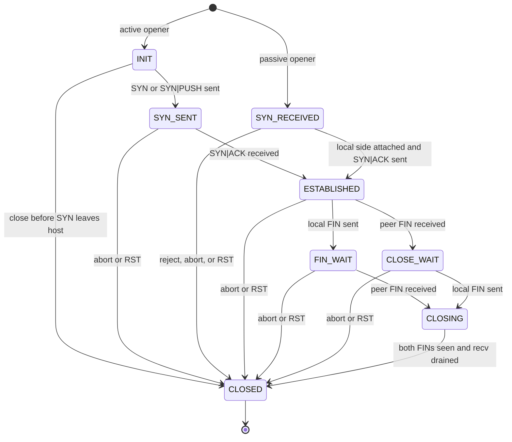

For non-INIT streams, `STREAM_CLOSED` is a protocol-visible tombstone rather
than immediate removal. The delayed-cleanup policy allows dispatch to suppress
duplicate late traffic without maintaining a separate retired-stream map.
Every CLOSED table entry is excluded from stream admission limits and
idle/drain accounting, including an application-held handle retained after
its tombstone timer expires. Timer expiry only makes it eligible for normal
per-stream cleanup, which waits for the application to release its held handle.
Session teardown instead removes the table entries and orphans held handles.

The following two sequence diagrams document the scheduler and callback handoffs
at the key state transitions: active opener and graceful close.

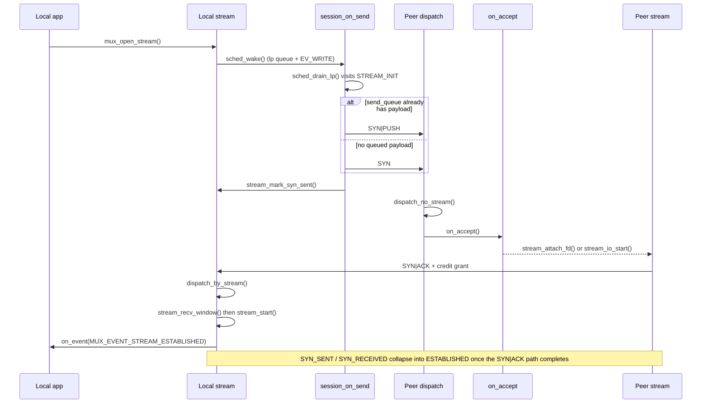

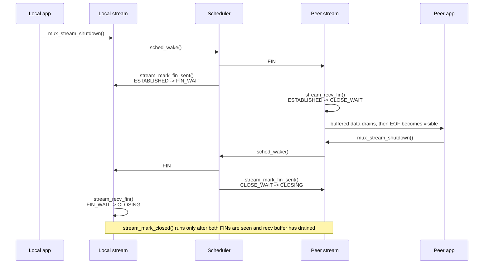

## 5. libev Watcher Topology

| Owner                | Watcher                 | Drives                                                                                     | Runtime Coupling                                                                                                                                                                     |
| -------------------- | ----------------------- | ------------------------------------------------------------------------------------------ | ------------------------------------------------------------------------------------------------------------------------------------------------------------------------------------ |
| Session              | `w_socket`              | transport read/write                                                                       | gated by `rx_open` and `tx_pending` rather than watcher churn                                                                                                                        |
| Session              | `w_timeout`             | inactivity timeout; reset on every inbound frame; teardown after `mux.timeout`s of silence (derived from `keepalive` by `conf_derive_mux_timeout()`, not itself a config key) | participates in hard teardown paths                                                                                                                                                  |
| Session              | `w_keepalive`           | keepalive PING frames the peer must answer with a PONG (encrypted TCP-keepalive over the tunnel); restarted only by a completed PING/PONG exchange in either direction, so neither end's liveness depends on the other's `keepalive` setting | armed only on the steady-state path                                                                                                                                                  |
| Session              | `w_send_timeout`        | pending-send stall detection (disabled when OS provides TCP_USER_TIMEOUT)                  | meaningful only while the one-frame sendbuf is pending                                                                                                                               |
| Session              | `w_connect_timeout`     | outbound connection / TLS timeout; reused as the resume-wait deadline (`SESSION_SUSPENDED`) and the graceful-close deadline (`SESSION_CLOSING`/`SESSION_CLOSE_WAIT`) | expiry during connect/handshake suspends a resumable session instead of closing it; expiry while suspended or closing tears the session down |
| Session              | `w_coalesce`            | delayed ACK / grant / Nagle expiry                                                         | owns the shared per-stream delay list and deferred session ACK budget                                                                                                                |
| Session              | `w_idle_timeout`        | client idle-close / lazy reconnect                                                         | feeds the upper-layer reconnect policy                                                                                                                                               |
| Stream (socket mode) | `socket.w_io`           | local fd recv/send pump                                                                    | present only when a real local fd is attached                                                                                                                                        |
| Stream (socket mode) | `socket.w_timeout`      | local send/connect stall detection                                                         | local-edge analogue of session send timeout                                                                                                                                          |
| Stream (direct mode) | `direct.w_io`           | synthesized `EV_READ` / `EV_WRITE`                                                         | user-visible readiness is derived from stream state rather than kernel fd readiness                                                                                                  |
| Server               | `w_sighup`              | config reload trigger                                                                      | fires `server_reload()` synchronously on the server loop                                                                                                                             |
| Server               | `w_sigint`, `w_sigterm` | graceful shutdown trigger                                                                  | sets `shutting_down` (which also refuses any further reload), stops listeners, dispatches `tunnel_shutdown()` to every tunnel and re-arms `w_maintenance` as the one-shot force-exit deadline                                   |
| Server               | `w_maintenance`         | deferred maintenance, then the shutdown deadline                                           | armed by `server_maintenance_kick()` only while work is outstanding (retired PSK tables, an emptied identity or `mux_connect` slot) and stopped by the first pass finding none; once `shutting_down` it is instead a one-shot 2 s force-exit deadline |
| Server               | `w_suspend`             | resume-from-suspend detection                                                              | `ev_check`, `ev_unref`'d so it never holds the loop open; at most once a second compares how far `CLOCK_BOOTTIME` (or the wall clock) advanced against `CLOCK_MONOTONIC` and calls `tunnel_drop_transport()` on every tunnel when they disagree by ≥ 15 s |
| Server               | `w_async` (threads)     | cross-thread event relay                                                                   | drains the server-side dispatcher queue after tunnel-to-server async relay                                                                                                           |
| Tunnel               | `w_maintenance`         | frame-cache trim                                                                           | armed by `tunnel_frame_free()` when a frame re-enters the cache, releases one cached frame per 10 s tick, and stops itself once the cache is empty                                   |
| UDP listener (server loop) | `w_read`          | lossymux datagrams from local UDP clients                                                  | reads up to 64 datagrams per wakeup and hands each to its client's tunnel (§23.2)                                                                                                   |
| UDP listener (server loop) | `w_sweep`         | client-route expiry                                                                        | armed while any route exists, every half `mux.lossymux.idle_timeout`; stops itself when the route table empties                                                                     |
| Flow table (tunnel loop)   | `w_sweep`         | flow expiry, with a FLOW-CLOSE to the peer                                                 | armed while any flow exists, same period; stops itself when the last flow goes                                                                                                      |
| Passive flow (tunnel loop) | `w_read`          | replies from the `connect` target                                                          | one connected UDP socket per flow the peer opened                                                                                                                                   |

Per-stream coalescing uses `delay_ticks` and `delay_pending` flags instead of
per-stream timers, keeping all delayed-grant state under the single
session-level `w_coalesce` clock.

### 5.1 Watcher Coupling Flags

| Flag            | Purpose                                                                                                                                                                                                  |
| --------------- | -------------------------------------------------------------------------------------------------------------------------------------------------------------------------------------------------------- |
| `rx_open`       | gates `EV_READ` on `w_socket`; cleared on transport EOF or error                                                                                                                                         |
| `tx_pending`    | gates `EV_WRITE` on `w_socket`; set when sendbuf or oobbuf has frames to flush; also set by TCP FIN or TLS `close_notify` receipt to wake `session_on_send` into the graceful-close path                 |
| `sched_queue`   | `enum` (NONE/DRR/LP) on each stream; `DRR` is the data ready queue, `LP` is the low-priority lifecycle queue (INIT SYN / CLOSED cleanup) drained by `session_on_send`; the queues are mutually exclusive |
| `delay_pending` | marks membership in the shared coalescing delay list                                                                                                                                                     |
| `nagle_flush`   | one-shot small-frame bypass after a delay-list expiry                                                                                                                                                    |

## 6. Hello Handshake Processing

The wire format is specified in [spec.md](spec.md); the implementation-specific
part is what the hello changes in runtime state.

| Decision point                        | Implementation consequence                                                                                                                                                                                                                                                |
| ------------------------------------- | ------------------------------------------------------------------------------------------------------------------------------------------------------------------------------------------------------------------------------------------------------------------------- |
| Stream 0 route                        | Hello, keepalive, and session ACK processing bypass the normal stream table.                                                                                                                                                                                              |
| `extensions.reject_inbound`           | Latches `peer_rejects_inbound_streams`, which blocks future active opener attempts.                                                                                                                                                                                       |
| Initial ClientHello                   | Server assigns the shared `session_id` and completes first-establishment handshake.                                                                                                                                                                                       |
| Resume ClientHello                    | `on_resume` may swap the transient accepted session for a suspended one that steals the new transport and replays unacked frames.                                                                                                                                         |
| ServerHello on the client             | A matching `session_id` alone confirms resume; `resume_seq` is not compared; it only sets the unacked-list trim point once resume is confirmed. Otherwise the client drops old streams and adopts the new session identity.                                              |
| TLS `close_notify` received on client | Clears `has_session_id`; next reconnect starts a fresh session. Contrast: a plain TCP FIN retains `has_session_id` so resume is attempted. `close_notify` signals an explicit server-side teardown (e.g. version mismatch); a bare TCP FIN may be a dirty transport loss. |
| Handshake completion                  | Fires `MUX_EVENT_ESTABLISHED` or `MUX_EVENT_RESUMED` and re-arms steady-state watchers.                                                                                                                                                                                   |

The two sequence diagrams are kept separate because first establishment and resume
involve different ownership transfers, even though both conclude in the same
steady state.

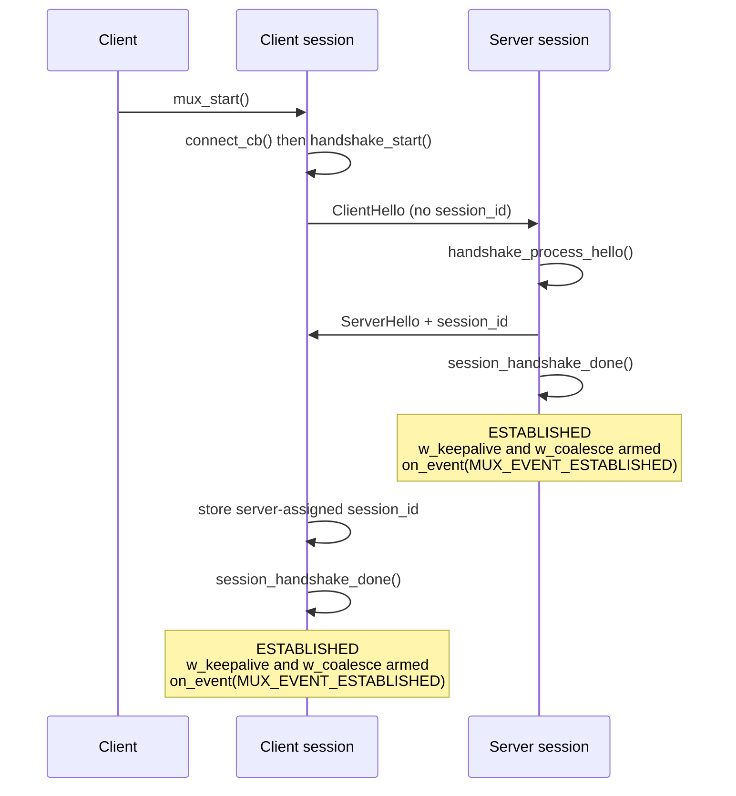

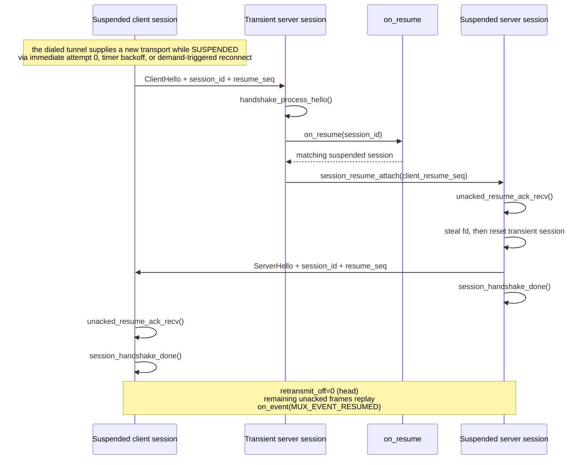

On the normal transport-loss path, both peers have already emitted
`MUX_EVENT_LOST` then `MUX_EVENT_SUSPENDED` before this sequence begins. If the
accepted side has not noticed the break yet, `session_resume_attach()` forces
it through `SESSION_SUSPENDED` before stealing the new fd.

Resume replay may retransmit a prior SYN|ACK for a stream that has already
left `STREAM_SYN_SENT` — for `STREAM_ESTABLISHED`, `STREAM_FIN_WAIT`,
`STREAM_CLOSE_WAIT` or `STREAM_CLOSING`, `validate_flags_by_stream()` accepts any
SYN that carries ACK. `dispatch_by_stream()` then consumes the whole frame and
does nothing else: no second callback, no state transition, no fast-open
payload delivery, and no receive-window credit. The piggybacked ACK credit is
deliberately not re-applied — it was granted when the original SYN|ACK was
processed, so applying it again would double-count it. This makes retransmit
replay safe even across streams whose opening handshake completed before the
transport was lost.

## 7. Inbound Data Path

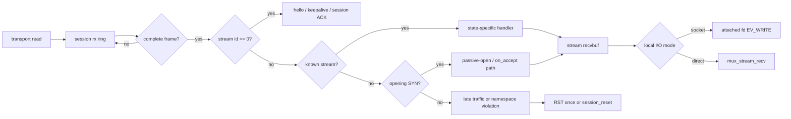

The ev callbacks an inbound byte crosses depend on local I/O mode. In the common
socket-mode case it is read by the transport watcher's `socket_cb` and written
out by the stream watcher's `local_cb` — two callbacks across two loop turns —
unless the recvbuf fast path drains it inline within the first callback.

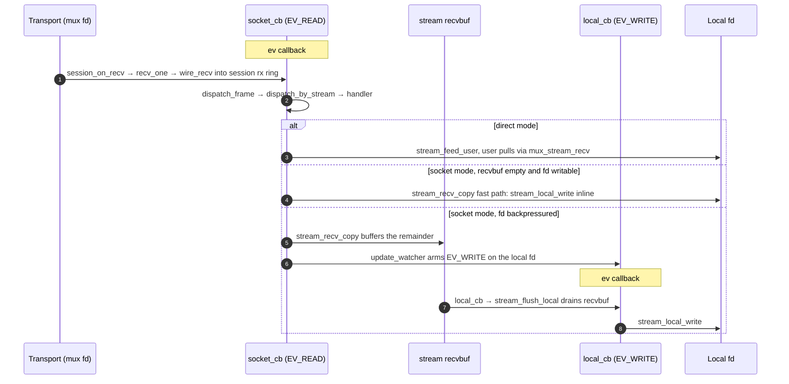

| Design Constraint                                                                                                                                                                                                                                                         | Significance                                                                                                                    |
| ------------------------------------------------------------------------------------------------------------------------------------------------------------------------------------------------------------------------------------------------------------------------- | ------------------------------------------------------------------------------------------------------------------------------- |
| The session receive ring is sized to the `mux.readahead` window (default 131072 bytes ≈ 8 full 16 KiB frames; `0` disables read-ahead, falling back to one local full frame `MUX_FRAME_HEADER_SIZE + max_payload`); it compacts when contiguous tail space runs out, grows on demand to assemble a single inbound frame larger than that, then shrinks back. Under `tls.socket_offload` the library owns the socket reads, so the window is just one frame and `mux.readahead > 0` instead drives `SSL_CTX_set_read_ahead`. | Receive-side work stays bounded for normal traffic without per-frame allocation, yet an oversized peer frame is still accepted; the read-ahead depth is tunable. |
| Unknown non-zero streams split into opening SYN, retired-stream traffic, and namespace violations.                                                                                                                                                                        | Valid late traffic gets one terminal RST; session-level violations still close the whole session.                               |
| Socket mode normally spans `socket_cb` (EV_READ) then `local_cb` (EV_WRITE); the `stream_recv_copy` fast path collapses both into the first callback when the recvbuf is empty and the fd is writable.                                                                    | The extra loop turn only appears under local-fd backpressure, not on every frame.                                               |

**Frame-size asymmetry.** `max_payload` (config `max_frame_size` minus the
8-byte header; `max_frame_size` defaults to 16 KiB, so `max_payload`
defaults to 16376 bytes, clamped to
`[MUX_MIN_FRAME_PAYLOAD, MUX_MAX_PAYLOAD_SIZE]`) bounds only
*outbound* framing: the send path chunks data into frames no larger than this,
and the implementation never emits an oversized frame. The receive path imposes
no matching limit — `dispatch_frame()` accepts any payload the 16-bit Length can
express (0–65535), growing the receive ring on demand to assemble a frame larger
than the local cap and shrinking it back afterward. The knob is therefore a
send-side chunking choice, not a negotiated wire limit (spec §2.3), so two peers
configured with different `max_frame_size` values interoperate. The sole place an
oversized inbound frame is rejected is an inbound PING whose payload exceeds
`max_payload`: it cannot be echoed into one of our own frames, so
`session_recv_ping()` closes the connection rather than send a truncated PONG
(spec §5.3.2).

## 8. Outbound Data Path

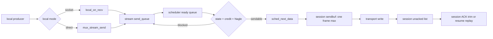

Outbound mirrors the inbound shape. Local data is read by the stream watcher's
`local_cb` (or handed in directly via `mux_stream_send`), enqueued, and the
transport watcher's `session_on_send` later pulls it through `sched_next_data` onto the
wire — again two callbacks across two loop turns, unless `session_flush`'s
low-load fast path inlines `session_on_send` within the producing callback.

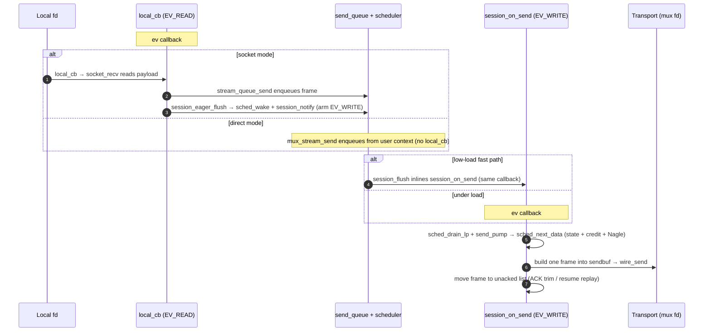

| Design Constraint                                                                                                                                                           | Significance                                                                                                           |
| --------------------------------------------------------------------------------------------------------------------------------------------------------------------------- | ---------------------------------------------------------------------------------------------------------------------- |
| Socket-attached reads and `mux_stream_send()` feed the same per-stream send queue.                                                                                          | Local I/O mode does not change fairness or flow-control semantics.                                                     |
| `sched_next_data()` applies state, send credit, and Nagle as one dequeue gate.                                                                                              | A stalled sender can be blocked by any of the three; there is no single “sendable” bit.                                |
| The session sendbuf holds at most one frame at a time.                                                                                                                      | Transport backpressure interleaves with scheduling decisions and prevents a hot stream from monopolizing the socket.   |
| `w_send_timeout` matters only while that single frame remains pending.                                                                                                      | Send-stall detection tracks transport progress, not queue depth.                                                       |
| `session_eager_flush()` is called from socket-mode `local_cb()` after reading local data; if no transport I/O is already in flight it inlines `session_on_send()` directly. | Avoids one libev event loop iteration on the response path, halving round-trip latency for request/response workloads. |

## 9. Scheduler and Control Batching Internals

### 9.1 Two-Phase Scheduling Model

Both phases run inside `session_on_send` on the same `EV_WRITE` activation: the
lifecycle drain runs first, then the data pump.

| Phase                                        | Trigger                                                   | Work kept here                                                                                       | Why it is split this way                                                                 |
| -------------------------------------------- | --------------------------------------------------------- | ---------------------------------------------------------------------------------------------------- | ---------------------------------------------------------------------------------------- |
| `sched_drain_lp()` (`session_on_send` entry) | `lp_pending` set and sendbuf clear (armed via `EV_WRITE`) | `STREAM_INIT` SYN / SYN\|PUSH, `STREAM_CLOSED` cleanup                                               | Batches lifecycle work so streams opened in one loop turn can launch together.           |
| `send_pump()` (`session_on_send` body)       | Transport became writable or was explicitly nudged        | sendbuf flush, retransmit replay, stream-0 out-of-band traffic, new control/data, per-stream ACK/FIN | Interleaves scheduling with socket backpressure instead of producing a long burst first. |

The lifecycle drain was formerly a separate `EV_IDLE` (`sched_cb`) barrier; it
now runs at the top of `session_on_send` so its frames coalesce into the same write. If
the sendbuf is still occupied when lifecycle work is queued, the drain is
deferred and the `session_on_send` epilogue (`sched_schedule()`) re-arms `EV_WRITE` once
the sendbuf clears.

When `send_stalled` is set, `EV_WRITE` stops scheduling fresh payload but still
flushes sendbuf, retransmit traffic, stream-0 control, and per-stream ACK/FIN
so the peer can drain the bottleneck. The `oobbuf` queue (PING/PONG
frames) is also exempt from `send_stalled`: the BDP estimator continues to
probe even during window exhaustion, which is exactly when an accurate BDP
reading is most needed.

Retransmit replay sends only PUSH data frames. `unacked_track_sent()` removes
stream-0 control frames (hello, standalone ACK, keepalive) from the unacked
list immediately after they are flushed to the wire, so they never appear in the
replay sequence. Replaying expired session-management traffic to a resumed peer
with fresh session state would be a protocol error.

### 9.2 Ready Queue Fairness Model (DRR)

| Step | Action                                                                                                                                                                    |
| ---- | ------------------------------------------------------------------------------------------------------------------------------------------------------------------------- |
| 1    | Use `drr_active` if present; otherwise dequeue the next ready stream.                                                                                                     |
| 2    | On the first dequeue of the stream in a round, add one quantum (`ss->max_payload`, the local max payload) to `deficit`.                                           |
| 3    | Send one PUSH frame and subtract its payload length from `deficit`.                                                                                                       |
| 4    | If the next queued frame still fits in `deficit`, keep the stream in `drr_active`; otherwise clear `drr_active` and re-enqueue it at the ready-queue tail (`sched_wake`). |
| 5    | Reset `deficit` whenever a turn produces no frame — the queue drains, credit is exhausted, or Nagle holds the head frame — not only when the queue empties, so a parked stream cannot bank quota while blocked; emit pending ACK/FIN after payload selection. |

| Mechanism                           | Invariant                                                                                                                   |
| ----------------------------------- | --------------------------------------------------------------------------------------------------------------------------- |
| Tail re-enqueue                     | A stream that exhausts its budget is appended to the FIFO tail, so every other ready stream is served before it runs again. |
| `drr_active`                        | One stream may consume the rest of its quantum without a dequeue/re-enqueue round trip.                                     |
| Quantum = `ss->max_payload` | Fairness is by bytes, not frames: many small frames and one full-size frame get the same byte budget per round.             |

### 9.3 Control Packing and Tombstones

| Mechanism                | Rule                                                                                                                                                                                                                                              | Rationale                                                                                                          |
| ------------------------ | ------------------------------------------------------------------------------------------------------------------------------------------------------------------------------------------------------------------------------------------------- | ------------------------------------------------------------------------------------------------------------------ |
| `sendbuf` / `oobbuf`     | stream-0 control frames (PING/PONG) are queued in `oobbuf` and flushed alongside `sendbuf`; in-place compaction strips stream-0 frames from a packed sendbuf entry.                                                                         | Standalone ACK, FIN, RST, and keepalive traffic share one batching path through the transport write.               |
| Per-stream control flags | Per-stream ACK/FIN piggybacks are tracked by the stream's own `ack_pending`/FIN flags and emitted by `sched_send_ctrl_flags()` during DRR scheduling, or batched by `sched_flush_ctrl()` scanning the ready queue when no data frame is produced. | Streams that owe a credit grant or FIN emit one piggybacked header rather than a standalone frame.                 |
| Tombstone linger         | Non-INIT streams remain in the table for `MUX_TOMBSTONE_PERIOD_S` after `stream_mark_closed()`.                                                                                                                                                   | Dispatch can suppress duplicate late traffic and answer at most one final RST without a second retired-stream map. |
| INIT fast close          | Streams closed before a SYN leaves skip tombstone retention.                                                                                                                                                                                      | The peer never observed the stream id, so there is no late-traffic state to preserve.                              |

## 10. Flow-Control Bookkeeping and Backpressure

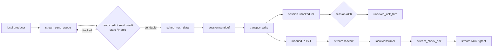

### 10.1 Counter Roles

| Counter set                     | Meaning                                                          | Implicit Invariant                                                                           |
| ------------------------------- | ---------------------------------------------------------------- | -------------------------------------------------------------------------------------------- |
| `send_window`, `bytes_sent`     | cumulative peer grant vs cumulative payload sent                 | Send credit is tracked cumulatively; the implementation does not reason in per-frame grants. |
| `queued_send_bytes`             | payload accepted from the local producer but not yet transmitted | Read credit subtracts queued bytes as well as transmitted bytes.                             |
| `unacked_bytes`                 | in-flight payload associated with pending peer acknowledgement   | Coalescing and delayed-ACK logic cares about bytes already emitted, not just queue depth.    |
| `recv_window`, `buffered_bytes` | receive budget vs receive memory currently occupied              | Memory pressure scales grants without rewriting already-buffered data.                       |
| `grant_sent`, `bytes_received`  | already-advertised receive credit vs cumulative bytes delivered  | The next grant is derived from the delta, not from current buffer occupancy alone.           |

The most subtle gate is `stream_read_credit_avail()`: local socket reads stop
when `queued_send_bytes + bytes_sent` would exceed peer credit, so the sender
cannot over-admit data into `send_queue`.

On the receive side, window updates are quantized to `MUX_WINDOW_UNIT`, so up to
one full `ss->max_payload` of over-window data is tolerated within
`recv_window`, which is the hard cap: `stream_recv_copy()` raises
`FLOW_CONTROL_ERROR` only when `buffered_bytes + payload_len` would exceed
`recv_window`. A peer may therefore hold slightly more credit outstanding than
the current window value without tripping a spurious error.

### 10.2 Critical Gating Rule

| Gate                  | Trips when                                                                                                         | Consequence                                                                                                                        |
| --------------------- | ------------------------------------------------------------------------------------------------------------------ | ---------------------------------------------------------------------------------------------------------------------------------- |
| Read credit           | `queued_send_bytes + bytes_sent >= send_window`                                                                    | Local socket reads stop before the peer grant is exhausted.                                                                        |
| Session send stall    | unacked bytes reach `session_window × MUX_WINDOW_UNIT` bytes                                                       | `EV_WRITE` stops scheduling fresh payload but still flushes sendbuf, retransmit traffic, stream-0 control, and per-stream ACK/FIN. |
| Expressible grant     | newly grantable credit is at least one `MUX_WINDOW_UNIT`                                                           | The `ack_pending` flag becomes meaningful only once the wire can represent the increment.                                          |
| Immediate ACK / grant | grantable credit reaches `2 * ss->max_payload`, or `unacked.unreported >= clamp(session_window / 4, 2, 8)` | The implementation bypasses delayed ACK so both peers do not wait on each other's timers.                                          |

`unacked_ack_trim()` clears `send_stalled` and the receive path nudges the
scheduler only after a session ACK shrinks the unacked list below the cap.

### 10.3 ACK Grant Triggering

Grants follow three paths:

| Path                  | Condition                                                      | Wire shape                                                                              |
| --------------------- | -------------------------------------------------------------- | --------------------------------------------------------------------------------------- |
| Immediate             | grantable credit reaches `2 * ss->max_payload`         | Piggyback in the next data frame when possible; otherwise emit a standalone ACK header. |
| Delayed per-stream    | grant is expressible but does not meet the immediate threshold | Put the stream on the coalescing delay list and flush on the next coalescing tick.      |
| Immediate session ACK | `unacked.unreported >= clamp(session_window / 4, 2, 8)`        | Emit a session ACK immediately to relieve session-wide backpressure.                    |

### 10.4 Receive-Buffer Pressure and Auto Window

For `x = recv_buffered_bytes`, the receive-pressure scale is (with
`s_lo = conf.mux.mem_pressure.lo` and `s_hi = conf.mux.mem_pressure.hi`):

- `scale(x) = 1` unconditionally when `s_hi <= 0` — pressure scaling is
  disabled, which is the default (`hi` defaults to `0`).
- Otherwise, an `s_lo` of `0` is first substituted with `s_hi / 2` (the
  schema's documented `lo: "0 = hi / 2"` default) before applying:
  - `scale(x) = 1` for `x = 0` or `x <= s_lo`;
  - `scale(x)` falls linearly from `1` to `1/8` for `s_lo < x < s_hi`;
  - `scale(x) = 1/8` for `x >= s_hi` once `x > s_lo`.

Equal watermarks are allowed: scaling remains `1` at the watermark and steps
to `1/8` above it.

`mux_stream_grant_inc()` applies that scale and then enforces a one-unit floor
when at least one `MUX_WINDOW_UNIT` is grantable; sub-unit credit yields no
grant. Pressure therefore reduces grants without suppressing all expressible
credit. The high watermark is not a hard receive-memory cap.

Automatic mode is opt-in per direction: `stream_window = 0` in config enables
`auto_stream_window`, and `session_window = 0` enables `auto_session_window`.
Either field may be auto without the other, but enabling either one activates
the shared BDP estimator (§12).  The estimator keeps an independent estimate
per link direction so asymmetric channel capacities yield independently sized
windows: `auto_stream_window` drives `stream_window` from the **rx** estimate
(`estimator.rx.effective_bdp`), while `auto_session_window` uses
`peer_stream_window` (updated on each SYN/SYN|ACK) as an initial floor and
then tracks the **tx** estimate (`estimator.tx.effective_bdp`) on each
PONG.  In auto mode the affected cap starts at `MUX_INITIAL_SEND_WINDOW /
MUX_WINDOW_UNIT` frames; `send_stalled` gates on `unacked_bytes >=
session_window × MUX_WINDOW_UNIT`, a byte-level cap that throttles payload
scheduling rather than closing the session.

Each direction is fed from its own source: inbound PUSH payload accumulates
into the rx sample via `estimator_add` (recv.c), and bytes that
`unacked_ack_trim` drains from the local `unacked` ring on an incoming session
ACK accumulate into the tx sample via `estimator_add_acked` (recv.c),
gated by the same `auto_stream_window || auto_session_window` condition.  The
tx sample reflects the sender's own achieved throughput × RTT (an "ack-clock"
BDP sample) and requires no inbound payload at all, so a near-pure sender
still grows its `session_window`.  See §12.1 for the per-direction equations.

## 11. Delayed ACK and Coalescing Timer Behavior

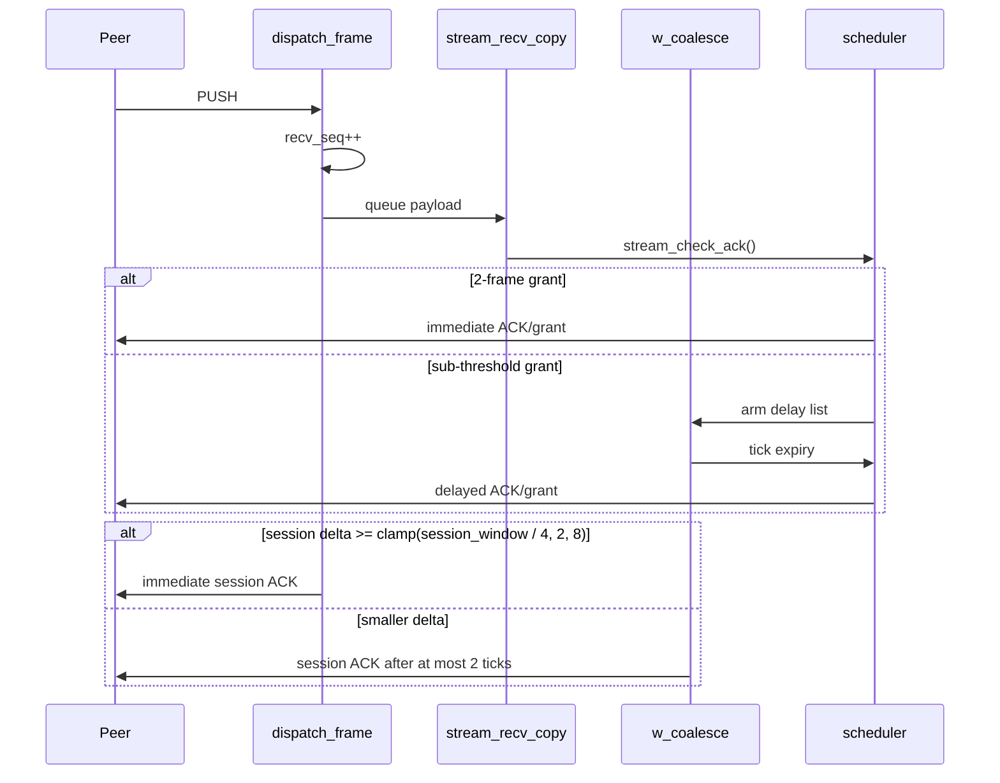

One session-level timer, `w_coalesce`, serves both delayed-grant paths:

| Mechanism             | Arm condition                                             | Bound                                       | Effect on expiry                                                                                  |
| --------------------- | --------------------------------------------------------- | ------------------------------------------- | ------------------------------------------------------------------------------------------------- |
| Per-stream coalescing | stream placed on the delay list with `delay_ticks`        | `delay_ticks * 40 ms`                       | remove from the list, set one-shot `nagle_flush`, apply pending grant, and enqueue for scheduling |
| Deferred session ACK  | `unacked.unreported` is nonzero but below the immediate threshold | `MUX_SESSION_ACK_MAX_TICKS * 40 ms` = 80 ms | emit a session ACK so the peer can trim its unacked list                                          |

This timer is shared, not per-stream. It starts after handshake completion,
restarts after resume handshake completion, and is stopped only when the
session leaves the steady-state path.

## 12. BDP Estimator

The estimator is active whenever `auto_stream_window` or `auto_session_window`
is enabled (`stream_window = 0` and/or `session_window = 0` in config).  It
learns a byte-granularity BDP **per link direction** from probe cycles driven
by either inbound PUSH payload (`estimator_add` → rx) or locally-sent bytes
that the peer has acked (`estimator_add_acked` → tx, called from
`unacked_ack_trim`).  Both directions share one PING/PONG probe cycle and the
RTT filter (RTT is inherently a round-trip quantity), but each keeps its own
bandwidth filter, BDP, `effective_bdp`, and STARTUP/TRACK phase, so an
asymmetric channel never sizes the slow direction's window from the fast
direction's bandwidth.  TCP handles congestion control; the estimator only
ensures the relevant windows stay ahead of the BDP:

- `session_update_stream_window` sets `stream_window` (when
  `auto_stream_window`) from the rx estimate on every PONG.
- `session_update_session_window` sets a floor for `session_window` (when
  `auto_session_window`) from `peer_stream_window` on every SYN/SYN|ACK, then
  tracks the tx estimate on every PONG.

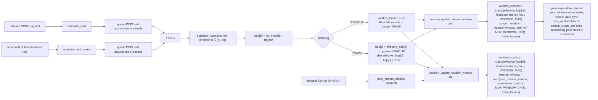

### 12.1 Core Equations

`session_update_stream_window` and `session_update_session_window` convert
`effective_bdp` to frames with **ceiling** division, so even a 1-byte
headroom translates to at least one extra frame.

```text
rtt_min_ns = wndfilter_update_min(rtt_wnd, WND_RTT_MIN_NS) -- 600 s window, shared

-- per direction d ∈ {rx, tx}:
bw_sample[d]      = min(sample[d], clamp_max) × 1e9 / rtt_ns
bw_max[d]         = wndfilter_update_max(bw_wnd[d], WND_BW_MAX_NS) -- 86400 s window
bdp[d]            = bw_max[d] × rtt_min_ns / 1e9
demand[d]         = bw_sample[d] × rtt_min_ns / 1e9 -- sample normalized to one min-RTT
window_limited[d] = demand[d] + demand[d] / 2 > effective_bdp[d]
                                                -- demand > 2/3 target

-- STARTUP phase (bw_max[d] == 0 → no-op)
if window_limited[d]:
    effective_bdp[d] ×= 3 (capped at WNDSIZE_MAX); stable_rounds[d] = 0
else:
    stable_rounds[d]++
    if stable_rounds[d] >= STARTUP_STABLE_ROUNDS: phase[d] = TRACK

-- TRACK phase
if effective_bdp[d] != 0 and bdp[d] > effective_bdp[d]:
    phase[d] = STARTUP; stable_rounds[d] = 0 -- effective_bdp[d] left as-is
else:
    effective_bdp[d] = bdp[d] + bdp[d] / 4

-- per direction d, converting effective_bdp[d] to a window in bytes
-- (bw_max[d] is the same windowed-maximum computed above):
feedback_floor[d] = clamp(bw_max[d] × WND_FEEDBACK_FLOOR_NS / 1e9, WNDSIZE_MIN, WNDSIZE_MAX)
                                                -- bw_max[d] == 0 leaves the floor at WNDSIZE_MIN
window_size[d] = clamp(effective_bdp[d], feedback_floor[d], WNDSIZE_MAX)

initial_frames = MUX_INITIAL_SEND_WINDOW / MUX_WINDOW_UNIT
stream_window  = max(ceil(window_size[rx] / MUX_WINDOW_UNIT), initial_frames)
session_window = max(peer_stream_window, ceil(window_size[tx] / MUX_WINDOW_UNIT), initial_frames)
```

The rx sample (fed by `estimator_add` from inbound PUSH payload) and the tx
sample (fed by `estimator_add_acked` from session-ACK-driven `unacked` ring
trims) share the same probe lifecycle: either one starts a cycle and queues a
PING, both accumulate independently while a PING is in flight, and a valid PONG
resets both to 0 at the end of the cycle (see
§12.2).  Beyond the shared cycle the directions never mix: each direction's
own sample drives its own `demand` and phase decisions, so a near-pure sender
(`sample[rx] ≈ 0`, `sample[tx] > 0`) gets the fast-startup ×3 ramp and TRACK
re-entry on its tx estimate while the idle rx estimate stays put.  `demand[d]`
is the per-direction sample **normalized to one min-RTT** (`bw_sample[d] ×
rtt_min_ns / 1e9`), not the raw byte count, so a transient RTT spike that
stretches a probe cycle and inflates `sample[d]` cannot trip spurious STARTUP
growth; for the same reason TRACK re-entry keys on the spike-immune `bdp[d]`,
not on `sample[d]`.  `clamp_max = INT_FAST64_MAX / 1e9` bounds each sample
before the `× 1e9` multiplication so neither can overflow `int_fast64_t`.

The `bw_wnd` 86400 s windows and the `rtt_wnd` 600 s window together act as a
natural floor: a measured peak bandwidth and minimum RTT persist for up to
their respective window sizes before an `effective_bdp` can fall materially
below the level it once supported.

`window_size[d]` (`estimator_rx_window_size()` / `estimator_tx_window_size()`),
not the raw `effective_bdp[d]`, is what `session_update_stream_window` and
`session_update_session_window` actually convert to frames (§12.4):
`effective_bdp[d]` is clamped up to `feedback_floor[d]` whenever the measured
`bw_max[d]` implies more than `WNDSIZE_MIN` bytes are needed to cover
`WND_FEEDBACK_FLOOR_NS` of feedback latency, and clamped down to `WNDSIZE_MAX`
either way. On a low-latency path this floor, not the estimated RTT, keeps a
high-bandwidth pipe's window from collapsing between window updates.

Constants: `WNDSIZE_MAX = UINT16_MAX × MUX_WINDOW_UNIT`, `WNDSIZE_MIN = 4 × MUX_WINDOW_UNIT`, `STARTUP_STABLE_ROUNDS = 16`, `WND_BW_MAX_NS = 86400 s`, `WND_RTT_MIN_NS = 600 s`, `WND_FEEDBACK_FLOOR_NS = 600 µs`, `MUX_PING_RATE_LIMIT_NS = 1 s`, `MUX_PING_STARTUP_INTERVAL_NS = 100 ms`, `MUX_PING_PROBE_TIMEOUT_NS = 5 s`.

### 12.2 Probe Lifecycle

| Event                                          | Effect                                                                                                                                                       |
| ---------------------------------------------- | ------------------------------------------------------------------------------------------------------------------------------------------------------------ |
| First eligible bytes with no probe in flight   | Start the calling direction's `sample = bytes`, queue PING with `last_probe_ns` payload, set `ping_in_flight`.                                               |
| More eligible bytes while PING is in flight    | While `now − last_probe_ns < MUX_PING_PROBE_TIMEOUT_NS` (5 s), accumulate into the calling direction's `sample`; no static clamp — overflow guard applied during the `bw_sample` calculation. |
| Eligible bytes after the probe timed out       | `now − last_probe_ns ≥ MUX_PING_PROBE_TIMEOUT_NS` with `ping_in_flight` still set: abandon the cycle — clear `ping_in_flight`, zero both directions' `sample` — then start a fresh probe from this call's bytes as in the first row (the timeout exceeds either `min_interval`, so the rate limit never holds it back). |
| `now − last_probe_ns < min_interval`           | Skip without starting a probe. `min_interval` is `MUX_PING_STARTUP_INTERVAL_NS` (100 ms) while either direction is still in STARTUP, else `MUX_PING_RATE_LIMIT_NS` (1 s) once both directions have reached TRACK — a fresh or re-ramping window probes faster to converge sooner. |
| Matching PONG (`ping_in_flight` and `sent_ns == last_probe_ns`) | `estimator_calculate` updates the RTT filter and both directions' BW filters and `effective_bdp` per §12.3; clears `ping_in_flight` and both `sample` counters, and advances `last_probe_ns` to now to gate the next probe. |
| Matching PONG with a non-positive RTT          | No filter is updated; the cycle ends as for a valid PONG (`ping_in_flight` and both `sample` counters cleared, `last_probe_ns` advanced to now).             |
| Stale PONG (no probe in flight, or `sent_ns != last_probe_ns`) | Discarded without updating any filter — including the late PONG of an abandoned probe, whose `sent_ns` no longer matches once a fresh probe has gone out. |

The estimator has no dedicated timer: probes are driven by payload arrival and
completed by a matching PONG, and the probe timeout is checked lazily by the
next eligible bytes rather than armed as a watcher.  The timeout exists because
a PONG is not guaranteed even on a healthy transport — a conforming peer may
rate-limit inbound PINGs and discard the excess
([spec.md §5.3.2](spec.md#532--rtt-probe-request-ping)), and `mux_session_recv_ping`
drops one on frame-pool OOM — so without it one lost PONG would hold the probe
gate shut and freeze the estimator at its last window for the session's life.
The abandoned cycle's samples have no RTT to pair with, so they are discarded
rather than carried into the next cycle.  On a dead transport
`estimator_suspend()` clears `ping_in_flight` and both directions' `sample`
counters as soon as the session leaves ESTABLISHED (§12.4).

### 12.3 `effective_bdp` Update Rules

Each valid PONG updates `rtt_wnd` (windowed-minimum RTT, shared) and then, for
each direction independently, `bw_wnd[d]` (windowed-maximum bandwidth); a zero
sample cannot raise a bandwidth peak.  `bdp[d]` is computed directly as
`bw_max[d] × rtt_min_ns / 1e9` without a separate BDP filter.
`effective_bdp[d]` is then adjusted according to that direction's phase
(`STARTUP` or `TRACK`), stored in `dir[d].phase`.

**STARTUP phase** — fast-start, searching for the bandwidth ceiling:

- **window_limited** (`demand[d] + demand[d]/2 > effective_bdp[d]`, i.e.
  `demand[d] > 2/3 × effective_bdp[d]`): the window is the throughput
  bottleneck; triple `effective_bdp[d]` (capped at `WNDSIZE_MAX`) and reset
  `stable_rounds[d]` to 0.
- **otherwise**: increment `stable_rounds[d]`; once it reaches
  `STARTUP_STABLE_ROUNDS` (16) consecutive non-window-limited cycles, the
  window is confirmed to have headroom — transition to TRACK.
- `bw_max[d] == 0` (no bandwidth sample yet): `effective_bdp[d]` is unchanged
  and `stable_rounds[d]` is not advanced.

**TRACK phase** — steady-state, tracking the current BDP:

- **Measured BDP outgrows the window** (`bdp[d] > effective_bdp[d]`, with the
  `effective_bdp[d] != 0` seed guard): link bandwidth has improved — re-enter
  STARTUP and reset `stable_rounds[d]` to 0, leaving `effective_bdp[d]`
  unchanged so STARTUP resumes growing from the current TRACK value. Keying on
  the spike-immune `bdp[d]` rather than the raw `sample[d]` avoids re-ramping
  on RTT jitter.
- **otherwise**: `effective_bdp[d] = bdp[d] + bdp[d] / 4`, where
  `bdp[d] = bw_max[d] × rtt_min_ns / 1e9`.

### 12.4 Window Update and Lifecycle

| Event                             | Result                                                                                                                                                                                                                                                                                                                                        |
| --------------------------------- | --------------------------------------------------------------------------------------------------------------------------------------------------------------------------------------------------------------------------------------------------------------------------------------------------------------------------------------------- |
| Manual mode                       | The estimator is inert; configured frame counts are used as-is.                                                                                                                                                                                                                                                                               |
| Automatic `stream_window`         | `auto_stream_window = true`; effective `stream_window` starts at `initial_frames` and grows with the rx `effective_bdp` (fed by inbound PUSH payload); the `bw_wnd` 86400 s window buffers shrinks—the estimate cannot fall below the level it once supported until the old peak ages out.                                                    |
| Automatic `session_window`        | `auto_session_window = true`; `session_window` starts at `initial_frames`, is floored by `peer_stream_window` on each SYN/SYN\|ACK, and tracks the tx `effective_bdp` (fed by the session-ACK-driven ack-clock) on each PONG, so a pure sender grows it without any inbound payload (§12.1).                                                  |
| `session_update_stream_window()`  | Called with `estimator_rx_window_size()` (§12.1's `window_size[rx]`, already floor/cap-clamped); `stream_window` is set to `max(ceil(window_size[rx] / MUX_WINDOW_UNIT), initial_frames)`; live streams expand `recv_window` immediately on grow; on shrink, each stream's `recv_window` is lazily synced down by `stream_check_ack` once `buffered_bytes + outstanding ≤ target`. |
| `session_update_session_window()` | Called with `estimator_tx_window_size()` (`window_size[tx]`); `session_window` is set to `max(peer_stream_window, ceil(window_size[tx] / MUX_WINDOW_UNIT), initial_frames)`; on growth, clears `send_stalled` if `unacked_bytes` is now under the new limit and wakes the scheduler.                                                          |
| Disconnect / stop                 | `stream_window` is set to `max(window_size(rx) / 2 / MUX_WINDOW_UNIT, initial_frames)` (§12.1's `window_size`, not the raw `effective_bdp`) without modifying the estimator struct.  The learned RTT and bandwidth filters are preserved across reconnects; `estimator_suspend()` clears `ping_in_flight` and both directions' `sample` counters (not `effective_bdp` or the filters) whenever the session leaves ESTABLISHED, so a stale pre-outage byte count can never pair with a post-resume RTT. |
| First enter auto mode on reload   | `estimator_init()` seeds both directions' `effective_bdp` from the current `stream_window * MUX_WINDOW_UNIT` and zeroes the rest of the estimator state.  Subsequent reloads that stay in auto mode preserve the learned state.                                                                                                               |

When `stream_window` decreases (TRACK trim to `bdp + bdp/4`, or manual reload), each
stream's `recv_window` is lazily synced to the new target inside
`stream_check_ack`: the shrink is applied as soon as
`buffered_bytes + outstanding ≤ target` (`outstanding = grant_sent − bytes_received`),
so the peer is never asked to respect a limit below what it has already been
granted.

## 13. Two Local I/O Modes

| Mode            | Local readiness source                                           | Outbound producer                             | Inbound consumer                        | Watchers                          |
| --------------- | ---------------------------------------------------------------- | --------------------------------------------- | --------------------------------------- | --------------------------------- |
| Socket-attached | kernel fd readiness                                              | attached-fd `EV_READ` pumps into `send_queue` | attached-fd `EV_WRITE` drains `recvbuf` | `socket.w_io`, `socket.w_timeout` |
| Direct          | `mux_stream_io_modify()` synthesizes readiness from stream state | `mux_stream_send()`                           | `mux_stream_recv()`                     | `direct.w_io`                     |

Both modes share the same queues, counters, ACK logic, and close semantics; the
only difference is how the local application edge is driven.

## 14. Error Handling and Reset Semantics

The wire rules live in [spec.md](spec.md#434--abrupt-shutdown). This section
keeps only the implementation-side reset path, late-traffic handling, and the
conditions that still escalate to whole-session failure.

### 14.1 Session-Fatal Conditions

| Trigger                            | Session-side result                                  |
| ---------------------------------- | ---------------------------------------------------- |
| Parse failure or transport failure | `session_reset()` → `SESSION_CLOSED`; non-resumable. |

### 14.2 Stream Abort Behavior

| Step                | Effect                                                                                                                                            |
| ------------------- | ------------------------------------------------------------------------------------------------------------------------------------------------- |
| `stream_abort()`    | sends or schedules reset signaling, clears unsent data, discards buffered receive data, and closes stream state immediately                       |
| Stale-control purge | queued control headers for the same stream are removed before the reset path commits, so obsolete ACK/FIN traffic cannot precede the terminal RST |

### 14.3 RST Transmission and Unknown-Stream Handling

| Case                                               | Implementation result                                                                                                                                |
| -------------------------------------------------- | ---------------------------------------------------------------------------------------------------------------------------------------------------- |
| Local live stream is aborted                       | discard stale queued non-RST frames for that stream, queue one RST with the chosen status, and transition the local stream state immediately         |
| Unknown-stream inbound RST                         | ignore it                                                                                                                                            |
| Retired-stream zero-length ACK or FIN              | ignore it                                                                                                                                            |
| Unknown-stream opening SYN                         | admit it through the passive-open path                                                                                                               |
| Valid non-SYN frame for an unknown non-zero stream | treat it as late traffic for a retired stream id, emit one terminal RST, remember that the id was already reset, then drop later duplicates silently |
| Late frame for an already closed live stream       | drop it in `dispatch_by_stream()` without reopening stream state                                                                                     |

This split keeps the session alive during stream teardown while still informing
the peer that the stream id is no longer live.

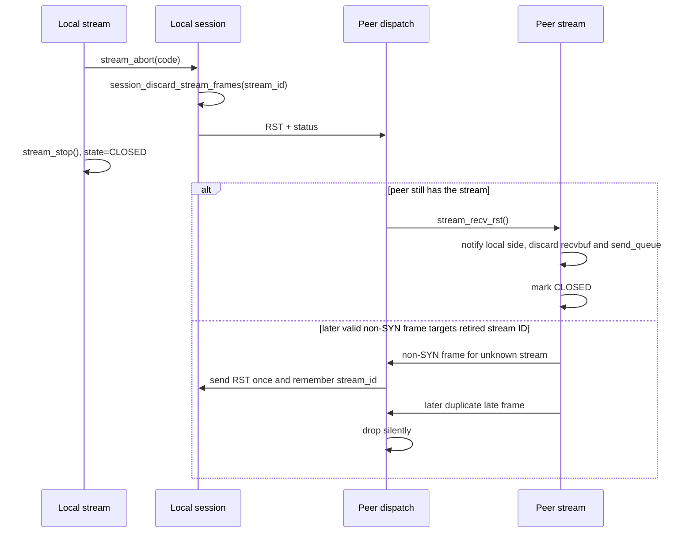

### 14.4 Session-Fatal Namespace Violations

`dispatch_no_stream()` escalates to `session_reset()` only when the received
frame breaks session-level namespace invariants rather than merely targeting a
retired stream id.

| Violation                               | Why it is session-fatal                                                                                                               |
| --------------------------------------- | ------------------------------------------------------------------------------------------------------------------------------------- |
| Invalid opening SYN flags               | an unknown stream may start only with `SYN` or `SYN \| PUSH`; anything else breaks the namespace before stream allocation even begins |
| Stream-id parity violation              | the peer used a stream id that is not legal for its endpoint role                                                                     |
| Reserved flag bits on an unknown stream | the frame is invalid at the session namespace boundary, not just at one stream                                                        |

These cases close the whole session immediately. They never enter
`SESSION_SUSPENDED`, so they are not resumable. Valid late non-SYN traffic for
a retired stream is handled by the single-RST path in Section 14.3 instead.

## 15. Teardown, Reconnect, and Idle Policies

| Situation                                                                           | Policy owner  | Outcome                                                                                                                                                                                                                |
| ----------------------------------------------------------------------------------- | ------------- | ---------------------------------------------------------------------------------------------------------------------------------------------------------------------------------------------------------------------- |
| Session teardown                                                                    | session layer | stop watchers first, then deep cleanup, then close transport, then hand control back to reconnect policy if applicable                                                                                                 |
| Resumable transport loss                                                            | session layer | enter `SESSION_SUSPENDED`, arm the resume timer, and emit `MUX_EVENT_SUSPENDED` on both dialed and accepted sessions                                                                                                   |
| Suspend of ≥ 15 s detected by `suspend_cb`                                          | server layer  | `tunnel_drop_transport()` shuts down the transport fd for every active tunnel; each session detects the loss via `MUX_EVENT_LOST` and `MUX_EVENT_SUSPENDED`; client tunnels re-dial via the normal transport-loss path |
| Dirty transport loss on a dialed tunnel with `idle_timeout == 0`                    | tunnel layer  | take immediate reconnect attempt 0 via `handle_transport_lost()` / `tunnel_do_connect()`                                                                                                                               |
| Dirty transport loss on an accepted tunnel                                          | tunnel layer  | observe `MUX_EVENT_SUSPENDED`, but do not start an outbound reconnect; wait for peer resume or timeout                                                                                                                 |
| Attempt 0 failed, or reconnect triggered from `MUX_EVENT_CLOSED` on a dialed tunnel | tunnel layer  | fall back to `tunnel_schedule_reconnect()` starting at 0.2 s and increment `reconnect_count`                                                                                                                           |
| Resume attempt failed and the session re-suspended (`MUX_EVENT_CONNECT_FAILED` while `MUX_STATE_SUSPENDED`) | tunnel layer | `handle_connect_failed()` calls `tunnel_schedule_reconnect()` with `.connect_failed.err`, continuing the ladder; an on-demand tunnel (`idle_timeout != 0`) waits for the next inbound connection instead |
| Connect failed with a no-route errno (`ENETDOWN` / `ENETUNREACH` / `EHOSTUNREACH`) | tunnel layer  | `tunnel_schedule_reconnect()` enters the ladder at its first 15 s rung rather than at 0.2 s: while the local path is gone, no shorter delay can produce a reachable peer.  The errno reaches it from either half of the dial -- `connect(2)`'s own return, or, when the failure only surfaces at connect completion, the `SO_ERROR` that `connect_cb()` records and reports as `MUX_EVENT_CLOSED`'s `.closed.err` (or `MUX_EVENT_CONNECT_FAILED`'s `.connect_failed.err` for a resume attempt) |
| Successful `MUX_EVENT_ESTABLISHED` or `MUX_EVENT_RESUMED` on a dialed tunnel        | tunnel layer  | reset `reconnect_count` to 0                                                                                                                                                                                           |
| Client idle timeout enabled                                                         | tunnel layer  | suppress attempt 0 and automatic CLOSED-time backoff; reconnect becomes demand-triggered from `tunnel_open_fd()`, which parks the triggering local connection (and any arriving while the dial is in flight) until the session establishes, then opens them as streams — or closes them if the attempt ends any other way |
| Client idle timeout expires                                                         | session layer | `idle_cb()` closes gracefully via `mux_session_initiate_shutdown()` (TLS `close_notify`, then TCP FIN) so a TLS server takes its own CLOSING path instead of suspending an orphan it can never resume; over plaintext the FIN is indistinguishable from a dirty loss, so the server still suspends that session until `resume_timeout`.  The session is not attachable while `CLOSING`, so a local connection arriving in that window is parked and marks the tunnel to redial from `handle_closed()` once the close completes |
| Demand-triggered reconnect from `SESSION_CLOSED`                                    | tunnel layer  | `session_attach_fd()` accepts a new fd from `SESSION_CLOSED` (after idle-close or resume-timeout expiry), transitions to `SESSION_CONNECT`, and starts a new connection attempt                                        |
| Stream-id exhaustion                                                                | session layer | `session_open_stream()` returns `NULL`; session stays up and the caller retries after old streams leave the parity space                                                                                               |

### 15.1 Session Capacity and Inbound Startup Control

`max_sessions` is a server-wide capacity budget. Outbound sessions reserve a
slot at tunnel creation; inbound transports reserve only after hello processing
has tried resumption and before replying to a fresh hello. The reservation and
reload of the limit share the accepted-registry mutex, so competing handshakes
cannot overbook the cap. Established and suspended sessions, and outbound
sessions reconnecting or waiting to redial, retain their slot until tunnel
teardown. Resumption attaches a temporary transport to an existing session and
uses that session's reservation. Unmatched or failed resume handoffs must acquire
a fresh reservation before falling back to a fresh session.

At capacity, configured outbound tunnels remain pending and maintenance retries
creation. Startup logs a warning for each configured tunnel it must defer, without
failing startup. Reload may lower the limit below current usage: existing sessions
remain live and new reservations wait until usage falls below the limit. A zero
limit keeps capacity unlimited.

Before creating an accepted transport, the mux listener applies the existing
startup guards (`is_startup_limited()`). Inbound half-open transports use no
session slot and can still attempt resumption at capacity, subject to these guards.

| Config field | Behavior |
| --- | --- |
| `startup_limit_full` | Hard cap on half-open transports; reject once the count already equals the limit. |
| `startup_limit_start` / `startup_limit_rate` | Admit the first `startup_limit_start` half-open connections freely, then reject with probability `startup_limit_rate`%. A start value of zero throttles from the first connection. |

## 16. Implementation Invariants for Maintainers

| Invariant                                                                                                                      | Significance                                                                                                                                                        |
| ------------------------------------------------------------------------------------------------------------------------------ | ------------------------------------------------------------------------------------------------------------------------------------------------------------------- |
| A budget-exhausted stream is re-enqueued at the ready-queue tail.                                                              | Tail re-enqueue keeps the DRR fairness boundary: every other ready stream is served before the re-enqueued one runs again.                                          |
| Read credit subtracts `queued_send_bytes` as well as transmitted bytes.                                                        | The local producer must not outrun peer credit by filling `send_queue` ahead of the wire.                                                                           |
| `nagle_flush` is one-shot.                                                                                                     | Delay expiry bypasses Nagle once, then normal gating resumes.                                                                                                       |
| Reset paths purge stale control before queuing RST.                                                                            | Obsolete ACK/FIN traffic must not precede the terminal reset.                                                                                                       |
| Serial counters rely on wrapping arithmetic; the pending session-ACK increment (`unacked.unreported`) is a plain count maintained directly.                        | Grant and replay bookkeeping stay in cumulative serial domains, while the session-ACK report is tracked in the wire's own increment domain, so no serial subtraction is ever computed. |
| Stream 0 carries control traffic only.                                                                                         | Control routing must stay isolated from ordinary stream dispatch.                                                                                                   |
| `unacked_ack_trim()` treats `last_ack_recv` as cumulative; the session-ACK Extra field is an increment, not an absolute value. | Session ACK trim logic depends on cumulative progress, not on an echoed absolute sequence number.                                                                   |
| After `session_resume_attach()`, `retransmit_off` must point to the unacked-list head (0).                                  | Resume replay must start with the oldest unacked frame before any new traffic is enqueued.                                                                          |
| `recv_seq` is incremented (with `unreported` in lockstep) before the per-stream handler runs.                                  | For sessions that survive, this matches the spec's processed-frame count; for frames that trigger `session_reset()`, the incremented value is never observed again. |
| `session_capture_sendbuf()` runs before `wire_discard_buffers()` in both `session_suspend()` and `session_resume_attach()`.    | A stream can independently abort or close while SUSPENDED (e.g. a local socket timeout), queuing a fresh frame into `wire.sendbuf` with no transport to send it on; capturing it into the unacked ring first means resume replay still delivers it instead of it being silently dropped by the discard. |

## 17. Source Map (Implementation)

| Concern                                                                                  | Files                                                                                        |
| ---------------------------------------------------------------------------------------- | -------------------------------------------------------------------------------------------- |
| **Top-level orchestrators**                                                              |                                                                                              |
| Process supervisor, signal handling, config reload, statistics, API endpoints            | [src/server.c](../src/server.c), [src/server.h](../src/server.h)                             |
| Mux-listener accept loop and bidirectional forwarding                                    | [src/listener.c](../src/listener.c), [src/listener.h](../src/listener.h)                     |
| Session-per-thread tunnel, reconnect policy, cross-thread relay                          | [src/tunnel.c](../src/tunnel.c), [src/tunnel.h](../src/tunnel.h)                             |
| Built-in observability HTTP endpoints                                                    | [src/api_server.c](../src/api_server.c), [src/api_server.h](../src/api_server.h)             |
| Process entry point, CLI argument parsing, daemonization                                | [src/main.c](../src/main.c)                                                                  |
| Configuration model, JSON parsing/validation                                             | [src/conf.c](../src/conf.c), [src/conf.h](../src/conf.h)                                     |
| TLS backend abstraction (OpenSSL / mbedTLS)                                              | [src/shim/tls.h](../src/shim/tls.h), [src/shim/tls_openssl.c](../src/shim/tls_openssl.c), [src/shim/tls_mbedtls.c](../src/shim/tls_mbedtls.c) |
| `--gencerts` certificate/key generation                                                 | [src/gencerts.c](../src/gencerts.c), [src/gencerts.h](../src/gencerts.h)                     |
| Shared helpers: CSPRNG bytes, exclusive file create/discard, address resolution, socket backpressure classification, MIME media-type validation, identity escaping, event/thread-assert and sockopt-logging macros; with TLS, ALPN tokenizing and certificate identity matching | [src/shim/util.c](../src/shim/util.c), [src/shim/util.h](../src/shim/util.h)                 |
| **Mux core (`src/mux/`)**                                                                |                                                                                              |
| API wrappers and public entry points                                                     | [src/mux/mux.c](../src/mux/mux.c), [src/mux/mux.h](../src/mux/mux.h)                         |
| Session state machine, transport lifecycle, suspend/resume                               | [src/mux/session.c](../src/mux/session.c), [src/mux/session.h](../src/mux/session.h)         |
| BDP/RTT estimator                                                                        | [src/mux/estimator.c](../src/mux/estimator.c), [src/mux/estimator.h](../src/mux/estimator.h) |
| Stream queues, local I/O modes, half-close/reset behavior, flow-control accounting       | [src/mux/stream.c](../src/mux/stream.c), [src/mux/stream.h](../src/mux/stream.h)             |
| Frame header coding and frame-list helpers                                               | [src/mux/frame.c](../src/mux/frame.c), [src/mux/frame.h](../src/mux/frame.h)                 |
| Hello JSON encoding/parsing and handshake transitions                                    | [src/mux/handshake.c](../src/mux/handshake.c), [src/mux/handshake.h](../src/mux/handshake.h) |
| Receive layer (1/3): frame parse, stream dispatch, flow-control accounting               | [src/mux/recv.c](../src/mux/recv.c), [src/mux/recv.h](../src/mux/recv.h)                     |
| Schedule layer (2/3): ready-queue DRR fairness, lifecycle scheduling, coalescing timer   | [src/mux/sched.c](../src/mux/sched.c), [src/mux/sched.h](../src/mux/sched.h)                 |
| Send layer (3/3): producer drain (retransmit/OOB/DRR), frame packing, flush entry points | [src/mux/send.c](../src/mux/send.c), [src/mux/send.h](../src/mux/send.h)                     |
| Raw transport send/recv and shared session buffer ownership transitions                  | [src/mux/wire.c](../src/mux/wire.c), [src/mux/wire.h](../src/mux/wire.h)                     |
| Session-level reliability: unacked frame ring, retransmit and session-ACK bookkeeping    | [src/mux/unacked.c](../src/mux/unacked.c), [src/mux/unacked.h](../src/mux/unacked.h)         |
| **lossymux UDP relay**                                                                   |                                                                                              |
| UDP listeners, sticky client routes, per-tunnel flow table                               | [src/udp.c](../src/udp.c), [src/udp.h](../src/udp.h)                                         |

## 18. Counters Architecture

Aggregate counters are owned by the server and written through pointer blocks so
session hot paths never need to know the owning struct.

| Piece                         | Implementation rule                                                                                                                   |
| ----------------------------- | ------------------------------------------------------------------------------------------------------------------------------------- |
| `mux_session_counters`        | `mux.h` stores pointer fields that a session writes through via `COUNTER_ADD`/`COUNTER_SUB`; pointer types are atomic under `WITH_THREADS` and plain otherwise. Not every pointer targets the same owner — see Update path. |
| Traffic subgroup              | `traffic` groups `byt_mux_recv`, `byt_mux_sent`, `byt_push_recv`, and `byt_push_sent`, wired to the owning tunnel's own counters (see Update path), not the server's.       |
| Datagram subgroup             | `dgram` groups the lossymux `pkt_dgram_sent`/`recv`/`dropped` and `byt_dgram_sent`/`recv` counters, per tunnel like `traffic`. The tunnel's flow table counts its own drops into the same `pkt_dgram_dropped` storage and keeps the `num_flows` gauge beside it. A datagram a UDP listener drops before any tunnel takes it lands in the server-thread `num_dgram_unrouted`, which `server_stats()` adds to the dropped total. |
| Update path                   | Two scopes, wired in `tunnel.c`: only the session-lifecycle fields (`num_session_*`, `num_sessions`, `num_session_halfopen`) point at the server's flat `server_counters`, so reading them needs no aggregation. Every other field — stream lifecycle, the traffic subgroup, `num_rst_sent`/`num_rst_recv`/`num_stream_errors`, and the `recv_buffered_bytes`/`send_buffered_frames`/`unacked_frames` gauges — points at the *owning tunnel's own* counters (`tunnel_stats`), which is what lets `/metrics` label them per tunnel; `server_stats()` sums them across every currently-live tunnel at snapshot time. `num_reconnects` is per-tunnel too, but the tunnel thread bumps it directly rather than through the pointer block. |
| Closed-tunnel fold            | `server_close_and_fold()` closes a tunnel via `tunnel_close_final()` and folds the counters it returns into `server_counters.closed`, so the monotonic totals survive tunnel churn; `server_stats()` seeds each total from that base and adds the live tunnels on top. `tunnel_close_final()` samples after joining the tunnel thread, so the increments teardown itself makes — `mux_close()` fails every stream still open — are folded too. Gauges are excluded — a closing session drains them to zero, so folding would leave the totals permanently overstated. Fold, container removal and `server_stats()` all run on the server thread, so no snapshot can see a tunnel both folded and still live; `server_force_close_snapshot()` folds while the pools still reference the tunnel, and relies on `server_stop()` clearing them in the same turn. The teardown task is never given up on: when the tunnel's ring is full `tunnel_close_final()` yields until the tunnel thread frees a slot, so every close joins the thread and no tunnel is left running unaccounted. |
| Stream-establish latency ring | Each tunnel keeps a fixed 256-entry ring and a monotonic counter; samples are written eagerly on `MUX_EVENT_STREAM_ESTABLISHED`. `server_stats()` derives per-tunnel percentiles from each ring and merges every ring for the process-wide figures.   |
| Read path                     | All aggregate reads go through `server_stats()`; per-session diagnostics are delivered by `on_event`, not by polling session objects. |

## 19. Identity Extension

The extension format is defined in [spec.md](spec.md); the implementation value
is that identity becomes a routing key.

| Item                                | Implementation note                                                                                            |
| ----------------------------------- | -------------------------------------------------------------------------------------------------------------- |
| Hello payload                       | When configured, hello carries `extensions.identity = <claimed-id>` from `mux_session_opts.identity`.          |
| Latched state                       | The peer's identity is stored in `handshake_ctx.peer_identity` for the session lifetime.                       |
| Server-side routing                 | Accepted sessions are wired to the matching service listener by peer identity.                                 |
| Client-side routing                 | `server_on_established()` maps the peer identity returned in `ServerHello` to the matching `identity.listen` entry and wires the dialed tunnel into that pool; `tunnel.c`'s `handle_connected()` runs on the tunnel thread and only formats the diagnostic tag from the same identity. |
| Config role: `identity.claim`       | local node identity, sent in every hello                                                                       |
| Config role: `identity.mux_connect` | one outbound mux session per entry                                                                             |
| Config role: `identity.listen`      | local listener keyed by peer identity                                                                          |
| Config role: `identity.verify`      | bind the claim to the peer certificate; carried per-tunnel in `tunnel.verify_identity` (set at creation, refreshed by `reload_task`) |
| Inbound mux streams                 | always forward to the root `connect` target regardless of advertised peer identity                             |

In client mode, one mux session per `identity.mux_connect` entry is created at
`server_start`; sessions are torn down in `server_stop` after the identity-based
wiring has been removed.

### 19.1 Certificate Binding (`identity.verify`)

Implements the optional identity-specific certificate pinning of
[spec.md](spec.md) §10.1. Nothing on the wire changes: the check is local, and
an enforcing node interoperates with a non-enforcing one in either direction.

| Item              | Implementation note                                                                                                                                 |
| ----------------- | ---------------------------------------------------------------------------------------------------------------------------------------------------- |
| Name form         | URI subjectAltName (RFC 5280 §4.2.1.6 `uniformResourceIdentifier`), opaque form `multiplexd:<percent-encoded identity>`. No authority component: that would invoke the "host MUST be an FQDN or IP" rule, and an identity is neither. |
| Extraction        | `tls_peer_cert_uri_sans()` walks the peer certificate's `GeneralName [6]` entries in each backend and returns them as one allocation. It fails the whole call on an embedded NUL rather than truncating — accepting the prefix is the null-prefix certificate attack, and neither backend checks it for us. |
| Comparison        | `identity_matches_cert()` (`shim/util.c`) matches the literal lowercase scheme, then decodes the tail with `url_unescape_path()` and compares octets. Decode-then-compare, not encode-then-compare: percent-encoding is not canonical, so a certificate issued by other tooling may escape a different but equally valid set of octets. The decoder's rejection of control characters (including `%00`) is what makes the final `strcmp()` sound. |
| Hook point        | `mux_callbacks.on_verify_identity`, fired from `mux_handshake_process_hello()` right after the peer's identity is latched and before the server/client dispatch. That is ahead of both `mux_session_handshake_done()` (so no stream is admitted) and the resume handoff (so the transport is still ours to reject), and one site covers both roles. |
| Effective identity | The value passed is the session's latched identity, not merely a claim present on this hello, so an identity a confirmed resume inherits from an earlier transport is re-proved against the certificate presented on the current one. A dialed session is reused across reconnects, so before verifying, a client drops the latched identity when the ServerHello neither claims one nor confirms the resume: a fresh session is verified against what this server claimed, never an earlier server's identity. |
| Resume            | `tunnel_resume_identity_ok()` additionally requires the claim on the new transport to equal the resumed session's, both-absent counting as equal. The claim is read via `mux_peer_identity()` rather than the tunnel's published snapshot, which is only refreshed on `MUX_EVENT_ESTABLISHED`/`MUX_EVENT_RESUMED` and so is not yet populated at lookup time. A mismatch releases the lookup's pin and falls back to a fresh session. |
| Plaintext         | `conf_check` rejects `identity.verify` without TLS credentials, and in a `WITH_TLS=0` build, as a hard error rather than ignoring it — unlike a performance hint such as `tcp.notsent_lowat`. `tunnel_on_verify_identity()` still fails closed if it ever sees a plaintext session. |

### 19.2 PSK Binding (`tls.psk`)

An alternative credential mode. No certificate is sent in either direction, so
the disclosure that `identity.verify` cannot avoid — a hub's certificate being
readable by any scanner that completes a key exchange — does not arise.

| Item | Implementation note |
| - | - |
| Label | `tls_psk_label()`: HKDF-SHA256 over the key, info `"multiplexd psk id v1"`, 16 octets hex. Derived from the *key*, not the identity: the label is cleartext in the ClientHello, and identities are low-entropy names that an unsalted hash would surrender to a wordlist. The hash is fixed at SHA-256 regardless of the negotiated suite, since both peers must agree without negotiating. Verified identical across backends against an independent HKDF. |
| Entropy | Publishing a one-way function of the key gives an offline oracle, so `TLS_PSK_MIN_LEN` is a floor on *length*, not entropy. `--genpsk` is the only supported source; a passphrase-derived key of legal length is still unsafe. |
| Key exchange | `psk_dhe_ke` only, set explicitly on both backends rather than left to library defaults. Bare `psk_ke` would drop forward secrecy. |
| Suite hash | A TLS 1.3 PSK binds to one hash, and the suite list is narrowed to that hash so negotiation cannot mismatch. The hash is always SHA-256, identically on both backends, whatever the order of `tls.ciphersuites`: mbedTLS hard-codes it for an external PSK on both 3.6 and 4.x (a client aborts on a server-selected suite of another hash; a server selects only SHA-256 suites), and the OpenSSL backend matches it rather than binding the first configured suite's hash, so any two peers agree. Each backend's `psk_restrict_ciphersuites()` keeps only the SHA-256 suites of the configured or default list, in their order (on OpenSSL, after `tls.ciphersuites` is applied, and *not* OpenSSL's default first preference of SHA-384), and fails context creation when none is left. Certificate mode is unaffected and negotiates from the full list. |
| Offered identity | Treated as hostile in both backends: unterminated and attacker-chosen, so length-bounded, with an embedded NUL rejected rather than truncated — a truncated label could resolve to another peer's key. |
| Callback plumbing | OpenSSL hangs credentials off the `SSL_CTX` via ex_data, as ALPN does, because `SSL_new` up-refs the `SSL_CTX` and not the wrapper. mbedTLS takes an opaque pointer but passes the `ssl` object, so the wrapper is recovered by cast, guarded by a `static_assert` that it is the first member. |
| Negotiated label | OpenSSL exposes no getter, so both backends record it as the handshake selects it; `tls_peer_psk_label()` reads that. |
| Identity binding | Implicit, unlike `identity.verify`: the binder already proves possession, so `tunnel_on_verify_identity()` only has to confirm the claim matches the peer owning that label. The resolver reaches the tunnel as a callback, since `server.h` includes `tunnel.h`. |
| Reload | The decoded table is rebuilt from the new config and the one it replaces is retired, not freed: tunnels resolve labels through it on their own threads and are only handed the new resolver by a dispatch (`tunnel_reload`, or `tunnel_set_psk` when that one was dropped). Retiring a table arms the maintenance tick, which frees it once no live tunnel reports it and no hold is out — a dispatch still queued on a tunnel's ring holds one, as does every TLS context registered with the table, whose parsed context a live connection keeps alive past `tls_ctx_free()`. The tick keeps retrying while the retired list is non-empty, since a hold can only be re-polled, and stops once it drains. |
| Storage | `struct config` keeps keys hex-encoded so the `strlen`-based erase in `conf_erase_credentials()` stays valid; decoded copies live in `struct psk_table` and are erased with it. `conf_free()` runs the same erase, so a config released on a failed start or reload does not return its keys to the heap intact, and the raw config buffer (the file, or a `PUT /config` body), which `conf_parse()` decodes in place, is erased as well. Format is validated where the key is first visible: an inline key in `conf_check()`, so a malformed one fails the parse (`PUT /config` answers 400); an `@path` key in `conf_inline_pem()`, after the file is loaded, since `conf_check()` sees only the reference. |

## 20. Tunnel Layer Threading Model

This section keeps only the ownership split and the crossings between the
server loop and tunnel loops. The mux core itself stays single-threaded per
session; the tunnel layer exists only to preserve that invariant while the
process hosts many sessions.

### 20.1 Ownership

| Owner                        | Owns or mutates                                                                                                  | How the other side reaches it                                                                                                    |
| ---------------------------- | ---------------------------------------------------------------------------------------------------------------- | -------------------------------------------------------------------------------------------------------------------------------- |
| Server loop                  | listeners, signal watchers, `accepted_tunnels`, service-to-tunnel map, graceful shutdown state, relay dispatcher | tunnel loops relay events here; session capacity is the mutex-protected exception below                                          |
| Tunnel loop (`WITH_THREADS`) | one mux session, all stream/session state under it, tunnel dispatcher, local inbound accept/connect path         | server loop submits control work through `dispatcher + ev_async`                                                                 |
| `accepted_mu`-guarded state  | `accepted_tunnels` and `identities`: inserted/removed or swapped by the server loop; `session_slots` and `session_limit`: capacity usage and limit | tunnel loops take shared locks for resume lookup (§20.4) and `handle_connected()`'s peer-tag lookup, and an exclusive lock to reserve capacity before a fresh server hello. Outbound creation, teardown and limit reload also update capacity under the exclusive lock; none of these locks grants access to mux state |
| Aggregate stats              | `server_stats` counters                                                                                          | updated from session threads atomically under `WITH_THREADS`, but counter writes do not transfer object ownership                |
| No-thread build              | server loop and tunnel loop collapse into one loop                                                               | dispatcher and relay become direct calls; wakeups, join, and shared-mutex resume lookup compile out, but ordering stays the same |

The local-only path stays on the tunnel loop: `tunnel_on_accept`, `stream_connect`,
and `mux_stream_attach` do not cross to the server loop.

### 20.2 Cross-Loop Paths

| Path                         | Primitive                                                  | Blocking | Rationale                                                        |
| ---------------------------- | ---------------------------------------------------------- | -------- | ---------------------------------------------------------------- |
| Server -> tunnel control     | `dispatcher + ev_async` via `t->disp` and `t->w_async`     | no       | start/config/open/shutdown must execute on the mux owner loop    |
| Tunnel -> server event relay | `dispatcher + ev_async` via `srv->disp` and `srv->w_async` | no       | session events must update server bookkeeping on the server loop |
| Resume lookup                | direct callback + shared `accepted_mu`                     | yes      | handshake needs an immediate answer before it can continue       |
| Session capacity             | direct reserve/release callback + exclusive `accepted_mu`  | yes      | reservation must decide admission before a fresh server hello; teardown releases the slot under the same lock |
| Final teardown               | `thrd_join()`                                              | yes      | last lifetime fence before freeing tunnel resources              |

The tunnel relays only what the server acts on: `MUX_EVENT_ESTABLISHED` and
`MUX_EVENT_RESUMED` (to `on_established` / `on_resumed`), `MUX_EVENT_LOST`, and
a `MUX_EVENT_CLOSED` that ends the tunnel. A dialed tunnel that will reconnect,
by backoff or on demand, keeps its CLOSED to itself; when `tunnel_shutdown()` or
a reload later turns its reconnect off while the session sits idle between
attempts (closed, suspended, or never started), the tunnel ends it and reports
that CLOSED then. A session with a transport attached at that moment — live, or
a resume attempt in flight — is ended the same way if it suspends later: its
transport is lost, or the attempt fails. `srv->disp` is one
16-slot ring shared by every tunnel, so a burst of events can fill it. An event
the ring refuses is not dropped: it waits on the tunnel's relay backlog
(`relay_head`/`relay_tail`), and `w_relay_retry` re-posts the backlog in order
every 10 ms from the tunnel's own loop until it lands or the relay is
disconnected. New events queue behind a non-empty backlog, so the server still
sees each tunnel's events in order.

Resume lookup, session capacity reservation and final teardown synchronously
return a result to the caller. Capacity release likewise runs directly under
the lock. `handle_connected()`'s `identities` read (§20.1) is also synchronous
and direct, but only to format a log tag; it blocks
on the lock, not on a reply from the other loop. Ordinary event delivery,
including `MUX_EVENT_CLOSED`, is asynchronous.

### 20.3 Server-to-Tunnel Control Path

`tunnel_dispatch()` is the write-side mailbox into the tunnel loop. It covers
startup, stream open, config/socket/TLS updates, shutdown, and the threaded
part of `tunnel_close()`.

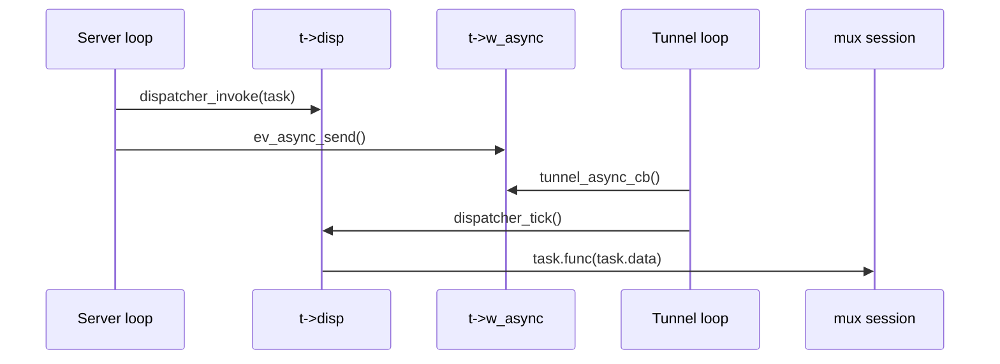

In `!WITH_THREADS`, the same ordering collapses into direct calls on the server
loop.

### 20.4 Synchronous Resume Lookup

Resume lookup and fresh-session admission cannot wait for the async relay queue.
For resume, the tunnel loop synchronously queries the server's registry for a
matching accepted session in `accepted_tunnels`. If the transport is not handed
off, capacity reservation (§15.1) must succeed before a fresh server hello.

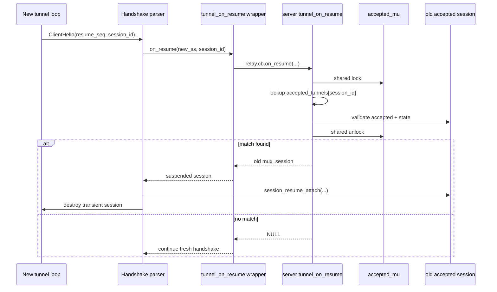

This lookup window is not the only place `accepted_mu` is taken (§20.1 lists
the others): shared locks cover table queries, and exclusive locks cover table
insert/remove/swap and capacity reservation/release/limit updates. It protects
table lifetime and session capacity, not general mux-session mutation.

### 20.5 Close Event and Final Teardown

Graceful shutdown starts from the server loop, but the actual `mux_shutdown()`
still runs on the owning tunnel loop. A dialed session that is already CLOSED
there — waiting out its reconnect backoff, or resting as an idle on-demand
tunnel — has no transition left to emit, so the tunnel reports the close
itself; either way the server hears every tunnel close, and `handle_closed()`
can end the loop before the force-exit deadline. After `MUX_EVENT_CLOSED` is
relayed back to the server loop, `tunnel_close()` disconnects future relays
and posts the teardown task, which closes the session on the worker and stops
its loop; then it joins the worker thread.

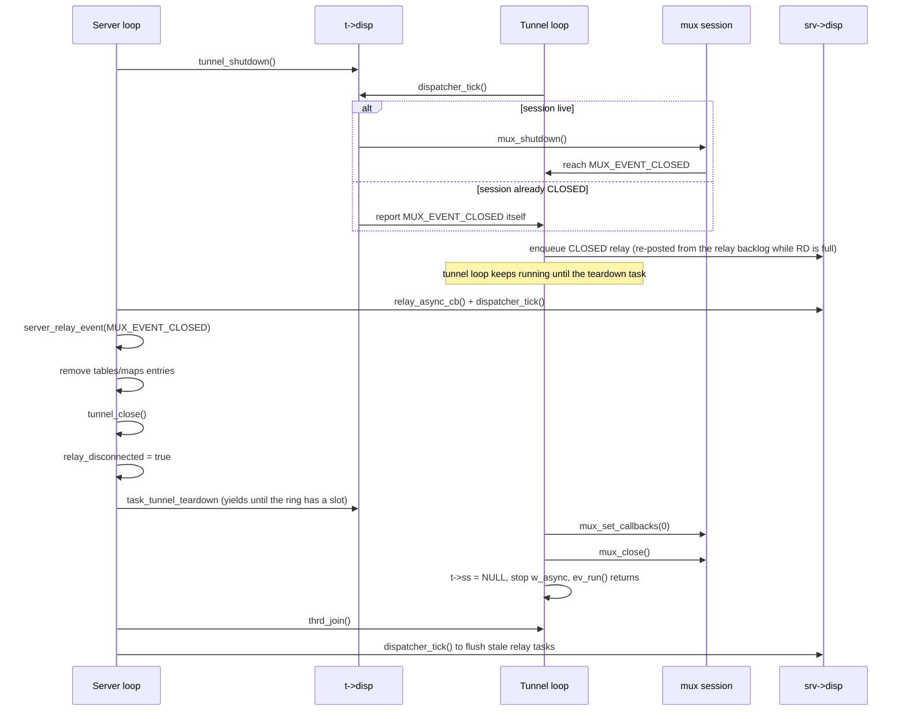

Forced stop adds one more relay-drain step before force-closing remaining
tunnels so a late `MUX_EVENT_CLOSED` cannot outlive the relay queue.
`server_stop()` sets `shutting_down` first, so a CLOSED handled by that drain
does not re-arm the maintenance tick, and `server_free()` stops the timer
again.

### 20.6 Practical Invariants

- Each mux session has exactly one execution loop at a time.
- All mux mutations happen on the tunnel loop, never directly on the server loop.
- Server bookkeeping stays on the server loop except for shared-locked table reads and exclusive-locked session capacity reservation/release callbacks.
- `accepted_mu` protects `accepted_tunnels`/`identities` table lifetime and session capacity, not general access to mux state.
- Normal event delivery is asynchronous; resume lookup, the peer-tag `identities` read, session capacity callbacks, and `thrd_join()` block.

## 21. Configuration Reload

The reload sequence has a synchronous phase on the server event loop followed by asynchronous settings updates and, normally, a drain-and-reconnect tail per session. A reduction of `max_sessions` preserves retained sessions instead of newly draining them; explicitly removed tunnels still retire.

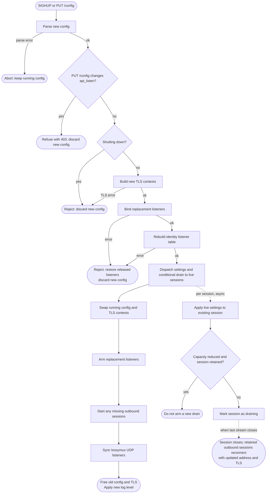

### 21.1 Synchronous Phase

The synchronous phase runs entirely on the server event loop, in the order below, before the SIGHUP handler or the `PUT /config` request returns.

| Stage            | Effect                                                                                                                                                                          |
| ---------------- | ------------------------------------------------------------------------------------------------------------------------------------------------------------------------------- |
| Parse            | New config is read from disk (SIGHUP) or from the `PUT /config` body. Any parse error aborts the reload and leaves the running config intact (`PUT /config` answers 400).       |
| API listener gate | `PUT /config` only: a body whose `api_listen` differs from the running value — a different string, or the field added or removed — is refused with 403 and discarded before anything is applied, so the API can never move its own listener; only SIGHUP can. The configured strings are compared as parsed, not resolved addresses. |
| Shutdown gate    | Once SIGINT/SIGTERM has begun a graceful shutdown, every reload is refused and the new config discarded (`PUT /config` answers 500).                                            |
| TLS rebuild      | `@path` PEM references are loaded, then the PSK table and the new TLS contexts are built from the new credentials. Any error aborts the reload.                                 |
| Listener prepare | Each top-level listener (`listen`, `mux_listen`, `api_listen`) whose configured address changed gets its replacement socket bound but not yet armed, so a bind failure rejects the reload with the old listeners still serving. An address that resolves to the one already bound keeps the live socket. A different address on the same port overlaps the live socket, which is therefore closed just before that bind and bound back if the reload is then rejected, here or at the routing update. |
| Routing update   | The identity-peer listener table is rebuilt from the new peer set. A peer kept with the same `listen` keeps its listener, socket and session pool untouched; the old sockets of changed and removed peers are all released before any replacement is bound, so peers may trade addresses. A bind failure (or OOM) rebinds the released sockets, undoes the listener prepare, and rejects the reload. A removed peer's sessions are closed immediately rather than drained. |
| Reload dispatch  | Each live session receives updated settings and a conditional drain request (see §21.2). No later stage can reject the reload.                                                                            |
| Config swap      | The new config, TLS contexts and PSK table become the active ones, and the `listen` and `mux_listen` listeners take the new socket options. Every replacement socket is bound by now and the identity listeners are already armed, but no top-level replacement is armed and no new outbound session exists yet. The phase never yields the loop, so nothing is accepted or dialed until it completes, and every accept and connect path afterwards uses the new config. |
| Listener commit  | Each prepared replacement is armed in place of its old socket, which is closed; a listener whose address was removed from the config is only stopped.                           |
| Session creation | Missing outbound sessions are started for any newly configured or previously closed slots.                                                                                      |
| UDP sync         | The lossymux UDP sockets follow the settled TCP listener addresses (§23.4). A failed UDP bind is logged but does not fail the reload.                                           |
| Cleanup          | Old TLS contexts and config are freed, the old PSK table is retired rather than freed (§19.2), and the log level is updated unless `--loglevel` overrides it.                   |

### 21.2 Drain Behavior

Before the synchronous phase completes, each live session is sent updated settings and its drain policy. The following happen on the session's own loop:

- **Live settings applied immediately**: session timeouts, keepalive intervals, window sizes, `nodelay`, and memory pressure thresholds take effect for the existing session without a reconnect.
- **Transport-shaping settings deferred**: `mux.max_frame_payload` and `mux.readahead` are fixed when the session is created, and `tls.socket_offload` is fixed per TLS connection (it describes how that connection was built), so a changed value applies only from the next session or connection, never to a live one.
- **Outbound address updated**: the target address for reconnects is updated so the next connection attempt uses the new destination.
- **Drain policy**: normally, the session stops admitting new inbound streams and shuts down gracefully when its last active stream closes; an idle session shuts down immediately. If a positive `max_sessions` is lower than the old positive limit, or replaces an unlimited limit, retained sessions are not newly drained. Their reservations remain held, and new reservations cannot succeed until usage falls below the new limit. Explicitly removed outbound slots still drain; removed identity peers still close immediately as described in §21.1.
- **Removed slots**: outbound sessions whose configuration slot was removed are prevented from reconnecting after they drain; one idle at that moment — closed, or suspended with no transport, which it could only regain by dialing — is ended at once, and one still live or mid-attempt is ended as soon as it suspends. The retirement is final: a slot re-added while its retired session still drains is not handed back to it, and the maintenance tick dials a fresh session once the retired one closes.

### 21.3 Asynchronous Reconnect

Once a drained session closes, the normal reconnect path (§15) re-dials using the updated address and the new TLS context from the already-swapped config. Accepted sessions do not reconnect; they are removed from the session table on close.

## 22. Per-Tunnel Frame Allocation

Each tunnel hands the mux core a per-tunnel `mux_frame_allocator` pointer block
(`tunnel_frame_alloc` / `tunnel_frame_free`), a thin wrapper over `malloc` /
`free` that sizes each object to the session's requested frame payload. There is
no shared server-wide pool, so frame allocation is contention-free per tunnel and
there is no server-level reclaim — the server's `w_maintenance` timer drains no
frame pool. Each tunnel trims its own cache instead, one object per tick of the
tunnel's `w_maintenance`, which `tunnel_frame_free()` arms when a frame re-enters
the cache and which stops itself once the cache is empty. Teardown must therefore
stop that timer only after the last `mux_close()`, or a frame released during
teardown would re-arm it against a tunnel about to be freed.

Frame allocation on the send path can partially fail: `mux_stream_send()` chunks
the caller's buffer into frames one at a time and returns the number of bytes
actually enqueued, which may be less than requested if a frame cannot be
allocated. Callers must check the return value and retry or back off accordingly.

## 23. lossymux Datagram Relay

The `lossymux` extension and its DATAGRAM / FLOW-CLOSE frames are specified in
[spec.md](spec.md) §5.2.3.3. `mux.lossymux.enabled` turns on two things:

- **Offering the extension.** It is active on a session only while both hellos
  offer it.
- **Binding the UDP side.** A UDP socket is bound beside every `listen` and
  `identity.listen` socket, and the peer's flows are relayed to the `connect`
  target over UDP.

Every step is best effort: a datagram that cannot move on at once is dropped and
counted, never queued without bound or retried.  The one uncounted drop is
teardown: datagrams still queued when a session is reset or closed
(`mux_wire_discard_buffers()`) or when a tunnel is freed (its FIFO, flushed
after the join) are released without being counted.

### 23.1 Wire-Side Datagram Path

| Piece        | Implementation rule |
| ------------ | ------------------- |
| Negotiation  | `handshake.offered_lossymux` records what the last hello sent, and `handshake.peer_lossymux` what the peer's last hello carried. `session_dgram_negotiated()` requires both. The server's resume path carries the peer flag across on `mux_transport.lossymux`, like `reject_inbound`. |
| Send queue   | `mux_dgram_send()` / `mux_dgram_close()` build a stream-0 frame into `wire.dgrambuf`. That queue is separate from `oobbuf`, so datagrams cannot starve PING/PONG or stream data. It is bounded by `mux.lossymux.queue` frames, and every datagram costs one pool frame, so the bound also caps its memory. |
| Staging      | `send_stage_next()` runs resume replay, then OOB, then datagrams and DRR data. The last two alternate one frame at a time through `wire.dgram_turn`, and an idle data turn goes to a datagram. The send-stall gate holds only stream payload, so datagrams still flow while it is closed. |
| Transmission | Staged frames pack into the sendbuf's open TLS record like any small frame. `mux_unacked_track_sent()` already strips stream-0 sub-frames, so datagrams never reach the unacked ring. |
| Receive      | `dispatch_ctrl_frame()` hands a DATAGRAM or FLOW-CLOSE to `on_dgram` / `on_dgram_close` only when negotiated and the flow id is non-zero; anything else stays a reserved frame. The payload is borrowed from `recvbuf` and consumed after the callback, the same pattern PING follows. Stream-0 frames never touch `recv_seq`. |
| Idle         | Datagrams in either direction re-arm a running `w_idle_timeout`, so an idle-close session carrying only UDP stays up. |

### 23.2 UDP Side: Listeners and Flows

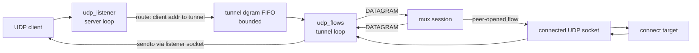

- **Listener (`udp_listener`, server loop).** `server_sync_udp_listeners()`
  binds it to the address its TCP listener actually holds, so a port-0 `listen`
  shares the port. The first datagram from a client calls `pick`, which uses
  the TCP routing (`server_pick_local()` or `identity_listener_pick()`), and
  that choice sticks as a route keyed by the zero-padded client address.
  `udp_listener_forget()` drops routes to a tunnel before
  `server_close_and_fold()` frees it.
- **Handoff.** Each datagram is copied into a `udp_dgram` holding a reference to
  the listener's `udp_socket`. With threads it joins the tunnel's FIFO, guarded
  by `open_mu` and bounded by `mux.lossymux.queue`, and `w_async` wakes the
  tunnel. Without threads it goes straight to `udp_flows_input()`.
- **Flows (`udp_flows`, tunnel loop).** The table has two indexes: flow id, and
  (socket, client) for active flows. Ids take the local stream parity and skip
  live ones. An active flow keeps a `udp_socket` reference and answers its
  client with `sendto()` on that shared descriptor, so the return path needs no
  cross-thread hop. A DATAGRAM for an unknown peer-parity id opens a passive
  flow: `forward_addr` is resolved synchronously, like a stream's connect
  target, and a connected socket is watched on the tunnel loop.
- **Session changes.** `MUX_EVENT_ESTABLISHED` (a fresh session) and
  `MUX_EVENT_CLOSED` reset the table, since the peer holds no flows then.
  `MUX_EVENT_RESUMED` keeps it. A datagram that arrives while the session is
  down triggers the same demand redial as a refused stream open
  (`tunnel_demand_redial()`).

### 23.3 Drop Points

| Where                         | Condition                                                          | Counted in                                            |
| ----------------------------- | ------------------------------------------------------------------ | ----------------------------------------------------- |
| UDP listener                  | no tunnel to route to, datagram truncated, allocation failure       | `num_dgram_unrouted`                                  |
| Tunnel FIFO (threads)         | `mux.lossymux.queue` datagrams already waiting                     | tunnel `pkt_dgram_dropped`                            |
| Flow table                    | lossymux not ready, no flow id free, unrelayable DATAGRAM, `send()`/`sendto()` failure | tunnel `pkt_dgram_dropped`         |
| Passive flow socket           | reply from the `connect` target truncated by the receive buffer    | tunnel `pkt_dgram_dropped`                            |
| `tunnel_dgram_input()`        | the tunnel's session already torn down                             | tunnel `pkt_dgram_dropped`                            |
| `mux_session_send_dgram()`    | not negotiated / not established, larger than the frame payload, `dgrambuf` full, pool allocation failure | tunnel `pkt_dgram_dropped` |
| `mux_session_suspend()`       | datagrams still queued when the transport is lost                  | tunnel `pkt_dgram_dropped`                            |

A full `dgrambuf` means the transport has not drained `mux.lossymux.queue`
frames. That is the congestion signal: the datagram is shed at the tail instead
of adding queueing delay.

### 23.4 Lifetimes and Reload

- A `udp_socket` is reference-counted, and references may be dropped on any
  thread; the last one closes the descriptor. A listener stopped by a reload
  drops its own reference, but flows still relaying through it keep the old
  socket open until they expire. The socket is bound with `SO_REUSEADDR`, so a
  new listener can take the same address meanwhile.
- The UDP side is synced after the TCP listeners settle on every reload. A
  listener whose TCP address is unchanged keeps its routes and picks up the new
  idle timeout; toggling `enabled` binds or closes the UDP sockets. A failed UDP
  bind is logged but does not fail the reload. At startup it fails the start
  like a TCP bind would.
- Existing sessions keep their negotiated state until their next handshake,
  like `reject_inbound`. The `mux.lossymux.queue` and `idle_timeout` values
  apply live through `mux_set_config()`.
- `udp_flows_free()` runs on the tunnel loop before `mux_close()` in every
  teardown path. The FIFO's leftover datagrams are freed with the pending opens
  once the tunnel thread has been joined.
